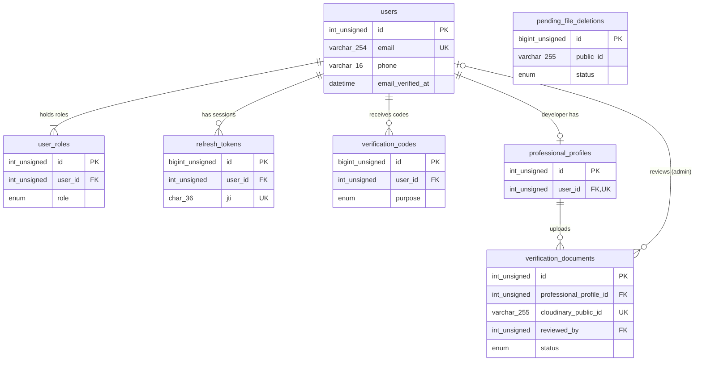

# Database Schema (global view)

MySQL + Sequelize. Requires **MySQL 8.0.16+ (target 8.4 LTS)**; the API refuses to start on older servers (DEC-020). Conventions: `.claude/rules/database.md`. Each module's details live in `docs/modules/<module>/db.md`. Update this file whenever a migration adds or changes a table.

Status: the auth tables are a **DRAFT** (2026-10-28, revised 2026-10-29 for buyer + developer scope and Cloudinary), not approved and not migrated on any database. See `docs/modules/auth/db.md`.

## ERD

## Table index

| Table                  | Module         | Purpose                                                                                                                        | Migration                                                  |
| ---------------------- | -------------- | ------------------------------------------------------------------------------------------------------------------------------ | ---------------------------------------------------------- |
| users                  | auth           | Accounts for buyers, developers and admins (agent deferred, DEC-017); credentials, email verification, preferred country       | `20261028183255-create-auth-tables.cjs` (draft)            |
| user_roles             | auth           | Roles an account holds (buyer, developer, admin); one email can be buyer and developer (DEC-019)                               | same                                                       |
| refresh_tokens         | auth           | Hashed refresh tokens by `jti`, for rotation and revocation (DEC-008)                                                          | same                                                       |
| verification_codes     | auth           | Hashed 6-digit email codes for email verification and password reset (DEC-010)                                                 | same                                                       |
| professional_profiles  | auth           | Developer business details from the Professional Info screens                                                                  | same                                                       |
| verification_documents | auth           | Uploaded ID, company certificate and profile photo (files in Cloudinary, DEC-016), each with its review status                 | same                                                       |
| pending_file_deletions | files (shared) | Outbox of Cloudinary files to delete after commit, with retry/backoff and a `failed` review state (DEC-018). No FKs on purpose | `20261029120000-create-pending-file-deletions.cjs` (draft) |
