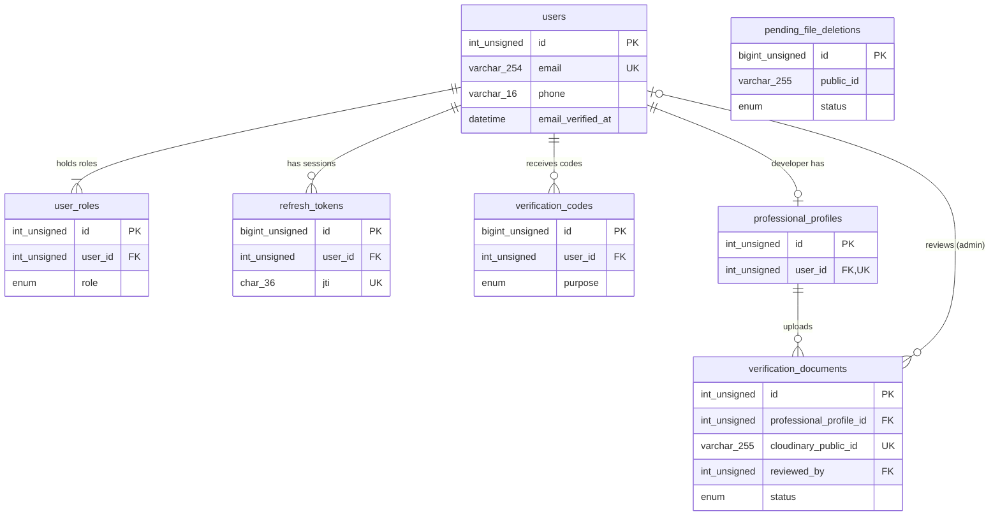
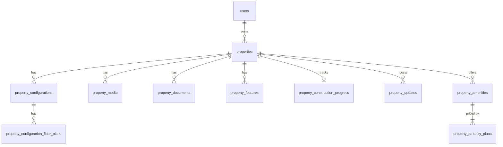
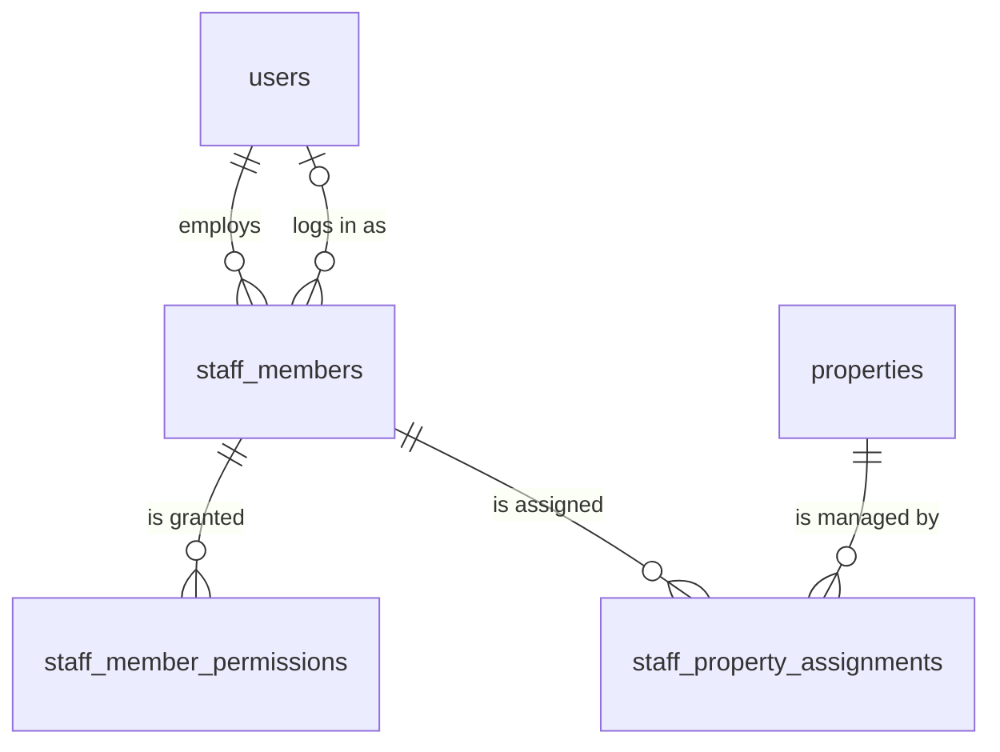

# Database Schema (global view)

MySQL + Sequelize. Requires **MySQL 8.0.16+ (target 8.4 LTS)**; the API refuses to start on older servers (DEC-020). Conventions: `.claude/rules/database.md`. Each module's details live in `docs/modules/<module>/db.md`. Update this file whenever a migration adds or changes a table.

Status: the auth tables are a **DRAFT** (2026-10-28, revised 2026-10-29 for buyer + developer scope and Cloudinary), not approved and not migrated on any database. See `docs/modules/auth/db.md`. The property and staff tables are a **DRAFT** too (2026-10-31, built on provisional answers the user will review; not migrated): see the [Property](#property-module) and [Staff](#staff-module) sections below.

## ERD



## Table index

| Table                  | Module         | Purpose                                                                                                                        | Migration                                                  |
| ---------------------- | -------------- | ------------------------------------------------------------------------------------------------------------------------------ | ---------------------------------------------------------- |
| users                  | auth           | Accounts for buyers, developers and admins (agent deferred, DEC-017); credentials, email verification, preferred country       | `20261028183255-create-auth-tables.cjs` (draft)            |
| user_roles             | auth           | Roles an account holds (buyer, developer, admin); one email can be buyer and developer (DEC-019)                               | same                                                       |
| refresh_tokens         | auth           | Hashed refresh tokens by `jti`, for rotation and revocation (DEC-008)                                                          | same                                                       |
| verification_codes     | auth           | Hashed 6-digit email codes for email verification and password reset (DEC-010)                                                 | same                                                       |
| professional_profiles  | auth           | Developer business details from the Professional Info screens                                                                  | same                                                       |
| verification_documents | auth           | Uploaded ID, company certificate and profile photo (files in Cloudinary, DEC-016), each with its review status                 | same                                                       |
| pending_file_deletions | files (shared) | Outbox of Cloudinary files to delete after commit, with retry/backoff and a `failed` review state (DEC-018). No FKs on purpose | `20261029120000-create-pending-file-deletions.cjs` (draft) |

## Cross-module ERD (auth -> property -> staff)

Migration order: auth (`20261028183255`) -> files (`20261029120000`) -> property (`20261030212741`) -> staff (`20261030212742`). The property and staff modules are built on separate branches; `feature/staff` needs the property migration file because of the one staff -> property FK.

```text
users (auth)
 |-- 1:N  properties.owner_id                       ON DELETE RESTRICT  ON UPDATE RESTRICT   [property -> auth]
 |-- 1:N  staff_members.employer_id                 ON DELETE RESTRICT  ON UPDATE RESTRICT   [staff -> auth]
 |-- 1:N  staff_members.user_id (nullable)          ON DELETE SET NULL  ON UPDATE RESTRICT   [staff -> auth]

properties (property)
 |-- 1:N  staff_property_assignments.property_id    ON DELETE CASCADE   ON UPDATE RESTRICT   [staff -> property]
```

Every other FK stays inside its own module. No property table references a staff table.

Deleting an account that owns properties or employs staff is blocked ([PROP-DEC-001](../execution/property/decisions/PROP-DEC-001-block-deleting-owner-accounts.md)): both FKs are RESTRICT, and the auth user-deletion service checks first and answers 409 CONFLICT with `authMessages.api.accountHasPropertiesOrStaff`. An account linked only as a staff member (`user_id`) can be deleted; the link becomes NULL.

## Property module

Details, column specs and assumptions: [docs/modules/property/db.md](../modules/property/db.md). Migration: `20261030212741-create-property-tables.cjs` (draft). PROP-Q-001 to PROP-Q-016 answered provisionally (PROP-DEC-001 to PROP-DEC-010); open: PROP-Q-017.



| Table                              | Purpose                                                                                                     |
| ---------------------------------- | ----------------------------------------------------------------------------------------------------------- |
| properties                         | A listing owned by a Developer account: type, purpose, category, status, location, area, units, price, text |
| property_configurations            | Unit types of a property (2 BHK, 3 BHK): area, price, total and available units, status                     |
| property_configuration_floor_plans | Floor plan files of a configuration (Cloudinary, PDF/JPG/PNG)                                               |
| property_media                     | Gallery images, videos and 360° tours (Cloudinary), in display order                                        |
| property_documents                 | RERA certificate, legal NOC, ownership proof and other documents (Cloudinary), with a status                |
| property_features                  | "Amenities & Features" items of a listing (one row per item)                                                |
| property_construction_progress     | Overall and per-phase progress and possession date of an under-construction property (1:1)                  |
| property_updates                   | Construction updates: title, description, optional image                                                    |
| property_amenities                 | Bookable amenities of a property (gym, pool, party hall): category, pricing type, status                    |
| property_amenity_plans             | Price plans of an amenity: plan name, billing cycle (hour, day, month), price                               |

## Staff module

Details, column specs and assumptions: [docs/modules/staff/db.md](../modules/staff/db.md). Migration: `20261030212742-create-staff-tables.cjs` (migrated on the staff folder's databases, not merged). STAFF-Q-001 to STAFF-Q-022 answered and final (STAFF-DEC-001 to STAFF-DEC-018).



| Table                      | Purpose                                                                                                   |
| -------------------------- | --------------------------------------------------------------------------------------------------------- |
| staff_members              | Team members a Developer adds: name, email, phone, role, status; optional link to their own login account |
| staff_member_permissions   | Areas a staff member may access (properties, leads & CRM, payments, marketing, facility)                  |
| staff_property_assignments | Properties assigned to a staff member (the only staff -> property FK)                                     |
