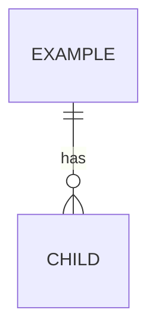

# [Module name] – Database

Produced by `/db-design`, reviewed by `/db-design-review`. Global view: `docs/database/SCHEMA.md`.

## ERD

## Tables

### [table_name]

| Column | Type         | Null | Default | Constraint | Zod rule (shared) | Notes |
| ------ | ------------ | ---- | ------- | ---------- | ----------------- | ----- |
| id     | INT UNSIGNED | no   | auto    | PK         | –                 |       |

Indexes:

- `idx_[table]_[cols]`: serves [query]

## Personal data and retention

- [column]: [why it is stored, retention]

## Assumptions and open questions

- [Item]
