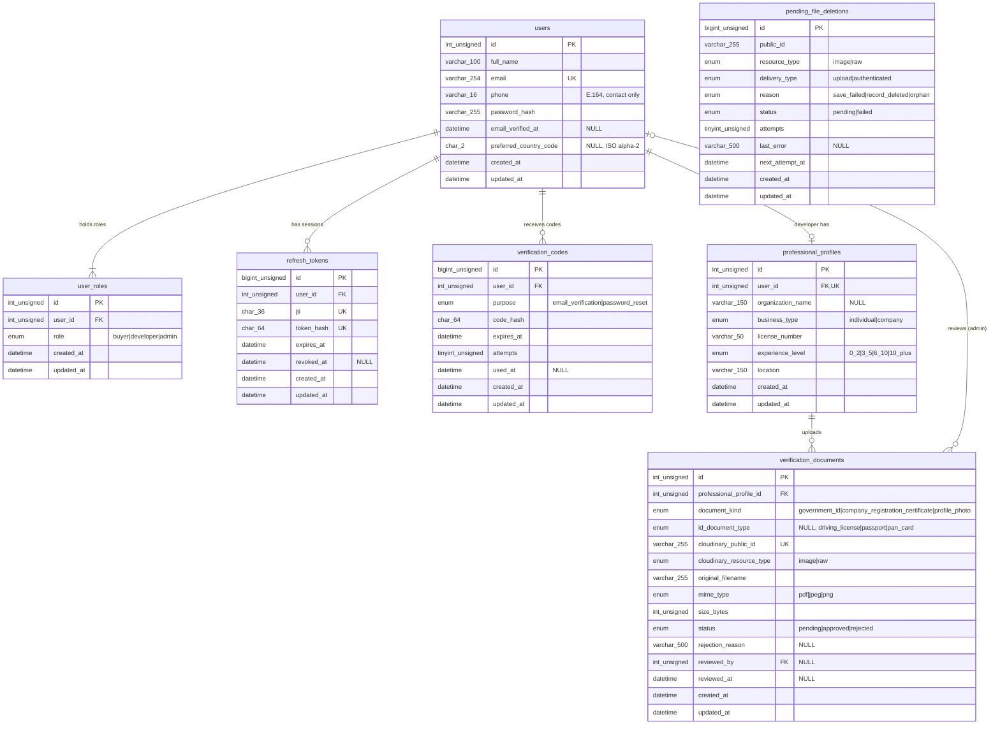

# Auth – Database

Status: **DRAFT (2026-10-28, revised 2026-10-29), not approved.** Produced by `/db-design` without the approval stops, at the user's request, so it can be grilled. Every decision not confirmed by the user or visible in Figma is tagged **ASSUMED** and has a matching open question (Q-xxx in `docs/execution/QUESTIONS.md`). Reviewed by `/db-design-review`: 2026-10-28 (no blockers) and 2026-10-29 (after the scope and Cloudinary changes).

**Grill done (2026-10-29):** the auth rules are in DEC-021 and DEC-022; rows below still tagged ASSUMED are now confirmed by those decisions unless an open question is named.

**Scope (confirmed 2026-10-29): buyer and developer only.** One account (one email) can be **both** a buyer and a developer (Q-031, DEC-019): roles live in `user_roles`, not on `users`. The developer is the property owner; the buyer buys. Agent sign-up, agent professional info and agent documents are **deferred** (not in the schema). Adding them later is a new migration that appends `'agent'` to `user_roles.role` and `'agency'` to `professional_profiles.business_type`.
Global view: `docs/database/SCHEMA.md`. Migration: `backend/src/migrations/20261028183255-create-auth-tables.cjs` (not run).

## Sources

- Confirmed by the user (2026-10-28): email verification is required for new users; mail is sent over SMTP (Gmail); SMTP settings live only in env vars (`SMTP_SERVICE_HOST`, `SMTP_SERVICE_PORT`, `SMTP_USER_NAME`, `SMTP_USER_PASSWORD`, `MAIL_FROM`) and never in the DB; the same mail flow serves forgot/reset password; `users.email_verified_at` and a hashed verification-code store with `expires_at`, `attempts`, `used_at`, `created_at`.
- Confirmed by the user (2026-10-29): uploaded documents are stored in **Cloudinary** (DEC-016). Cloudinary credentials are env vars only, never in the DB.
- DEC-008: refresh tokens stored as a SHA-256 hash with their `jti`, rotated and revocable.
- Figma: every frame on the "Auth Module" page (see `figma.md`).

## Mailer (not built)

The backend needs a mailer service (nodemailer, SMTP over TLS on port 465, `secure: true`) configured from the env vars above, validated in `config/env.js`. It sends the 6-digit code for `email_verification` and `password_reset`. Mail content and the SMTP credentials are never stored in the DB or logged. Not part of this change.

## Document storage: Cloudinary (not built)

The backend needs a Cloudinary service (the `cloudinary` Node SDK) configured from env vars, validated in `config/env.js`. Proposed names (to confirm, Q-030): `CLOUDINARY_CLOUD_NAME`, `CLOUDINARY_API_KEY`, `CLOUDINARY_API_SECRET`. Rules:

- Upload server-side with `type: 'authenticated'`, so files are never reachable by a public URL. PDFs go up as `resource_type: 'raw'` and JPG/PNG as `'image'` (`chk_verification_documents_resource_type`).
- The backend generates the `public_id` (e.g. `auth/documents/<profile id>/<random>`), never from the user's filename.
- The DB stores only `cloudinary_public_id` and `cloudinary_resource_type`, no URL. The owner or an admin gets a short-lived signed URL generated on request.
- Deleting a row never deletes the Cloudinary file by itself (the CASCADE runs in MySQL only). The service calls `destroy(public_id, { resource_type, type: 'authenticated' })` on account deletion and on retention cleanup.
- Check the file type and size on the server before uploading (magic bytes, max 10 MB, which is also Cloudinary's free-plan file limit).

## What the Verify frames show (FROM FIGMA)

- A **code**, not a link: six single-character boxes, title "Verify Your Account", text "We've sent a 6-digit code to <email>. Please enter it below to continue.", button "Verify".
- Resend text: "Don't Receive the code? Resend" (link). **No timer or countdown** is shown.
- The four Verify frames (`13038:4052`, `13038:3920`, `13038:3992`, `13038:4022`) are pixel-identical; they differ only by the journey row (password reset, buyer, agent (deferred), developer).
- Not in Figma, so ASSUMED: code expiry 10 minutes; 5 wrong attempts invalidate the code; resend cooldown 60 seconds and at most 5 codes per purpose per user per hour; a new code supersedes older unused ones; digits only (0-9).

## Field inventory

Tags: **Field** = does the field exist in Figma; **Req.** = required-ness source. Required-ness is FROM FIGMA only when the design shows it (here only the "(optional)" labels, the 6-digit count and the always-selected tab). A row is tagged FROM FIGMA overall only when both are; otherwise ASSUMED.
The three Sign Up frames (`4146`, `4232`, `4318`) have identical fields, so they share rows.

| #   | Screen                        | Field label (exact)                                                                      | Input type                                                           | Required?                                       | Dropdown options (exact)                                       | Target column                                                       | Tag                              |
| --- | ----------------------------- | ---------------------------------------------------------------------------------------- | -------------------------------------------------------------------- | ----------------------------------------------- | -------------------------------------------------------------- | ------------------------------------------------------------------- | -------------------------------- |
| 1   | Log in                        | Email/ Phone number (placeholder "Enter Email/ Phone number"); becomes "Email" (DEC-022) | email                                                                | yes (DEC-022)                                   | –                                                              | lookup `users.email` (login is by email only)                       | FROM FIGMA (field), rule DEC-022 |
| 2   | Log in                        | Password ("Enter Password")                                                              | password + eye toggle                                                | yes (ASSUMED)                                   | –                                                              | checked against `users.password_hash`                               | ASSUMED                          |
| 3   | Forgot Password               | Email ("Enter Email")                                                                    | email                                                                | yes (ASSUMED)                                   | –                                                              | lookup `users.email`; creates `verification_codes` (password_reset) | ASSUMED                          |
| 4   | Verify (x4)                   | 6-digit code (no label)                                                                  | 6 one-digit boxes                                                    | yes, 6 digits (FROM FIGMA)                      | –                                                              | checked against `verification_codes.code_hash`                      | FROM FIGMA                       |
| 5   | Reset password                | New Password ("Enter New Password")                                                      | password + eye                                                       | yes (ASSUMED)                                   | –                                                              | `users.password_hash`                                               | ASSUMED                          |
| 6   | Reset password                | Confirm Password ("Enter Confirm Password")                                              | password + eye                                                       | yes (ASSUMED)                                   | –                                                              | not stored (must equal New Password)                                | ASSUMED                          |
| 7   | Sign Up (Buyer/Developer)     | role tabs (no label)                                                                     | tabs                                                                 | yes, one tab always selected (FROM FIGMA)       | Buyer, Agent (deferred), Developers                            | `user_roles.role` (a row per role held)                             | FROM FIGMA                       |
| 8   | Sign Up                       | Full Name ("Enter Name")                                                                 | text                                                                 | yes (ASSUMED)                                   | –                                                              | `users.full_name`                                                   | ASSUMED                          |
| 9   | Sign Up                       | Email ("Enter Email")                                                                    | email                                                                | yes (ASSUMED)                                   | –                                                              | `users.email`                                                       | ASSUMED                          |
| 10  | Sign Up                       | Phone number ("Enter Phone number")                                                      | tel (no country-code picker shown)                                   | yes (ASSUMED)                                   | –                                                              | `users.phone`                                                       | ASSUMED                          |
| 11  | Sign Up                       | Password ("Enter Password")                                                              | password + eye                                                       | yes (ASSUMED)                                   | –                                                              | `users.password_hash`                                               | ASSUMED                          |
| 12  | Sign Up                       | Confirm Password ("Enter Confirm Password")                                              | password + eye                                                       | yes (ASSUMED)                                   | –                                                              | not stored                                                          | ASSUMED                          |
| 13  | Select a country (buyer row)  | country list (no label)                                                                  | single-select list with flags                                        | yes (ASSUMED; one is pre-selected in the frame) | United Arab Emirates, Singapore, United States, United Kingdom | `users.preferred_country_code`                                      | ASSUMED                          |
| 19  | Professional info (developer) | Company Name (optional) ("Enter Name")                                                   | text                                                                 | no (FROM FIGMA)                                 | –                                                              | `professional_profiles.organization_name`                           | FROM FIGMA                       |
| 20  | Professional info (developer) | Type of Developer: ("Select")                                                            | select                                                               | yes (ASSUMED)                                   | Individual, Company                                            | `professional_profiles.business_type`                               | ASSUMED                          |
| 21  | Professional info (developer) | License / Registration Number                                                            | text                                                                 | yes (ASSUMED)                                   | –                                                              | `professional_profiles.license_number`                              | ASSUMED                          |
| 22  | Professional info (developer) | Experience Level ("Select")                                                              | select                                                               | yes (ASSUMED)                                   | 0–2, 3–5, 6–10, 10+                                            | `professional_profiles.experience_level`                            | ASSUMED                          |
| 23  | Professional info (developer) | Location ("Enter Location")                                                              | text                                                                 | yes (ASSUMED)                                   | –                                                              | `professional_profiles.location`                                    | ASSUMED                          |
| 27  | Upload Document (developer)   | Government ID: "Select Document Type"                                                    | select                                                               | yes (ASSUMED)                                   | Driving License, Passport, PAN Card                            | `verification_documents.id_document_type`                           | ASSUMED                          |
| 28  | Upload Document (developer)   | Government ID file                                                                       | file dropzone; "Supported formats: PDF, JPG, PNG", "Max size: 10 MB" | yes (ASSUMED)                                   | –                                                              | `verification_documents` row, kind `government_id`                  | ASSUMED                          |
| 29  | Upload Document (developer)   | Company Registration Certificate file                                                    | file dropzone; same hints                                            | yes (ASSUMED)                                   | –                                                              | kind `company_registration_certificate`                             | ASSUMED                          |
| 30  | Upload Document (developer)   | Profile Photo file                                                                       | file dropzone; same hints                                            | yes (ASSUMED)                                   | –                                                              | kind `profile_photo`                                                | ASSUMED                          |
| 31  | Pending / Approved / Reject   | per-document status badge (display)                                                      | read-only                                                            | n/a                                             | Pending, Approved, Reject                                      | `verification_documents.status`                                     | FROM FIGMA                       |
| 32  | Reject                        | "Reject reason:" (display, e.g. "Document is blurry or unreadable")                      | read-only                                                            | n/a                                             | –                                                              | `verification_documents.rejection_reason`                           | FROM FIGMA                       |

Counts (buyer + developer scope): **24 rows: 5 FROM FIGMA, 19 ASSUMED** (all exist in Figma; 19 rows are ASSUMED only because required-ness is not shown). Row numbers are kept from the first draft; rows 14-18 and 24-26 were the agent screens (Professional Info `4404`, Upload document `4528`) and are **deferred** with the agent role.
The Uploaded frame (`4887`, developer) shows file name and "Size: 4.54 mb": it backs `original_filename` and `size_bytes`.
Not fields but visible: "Continue with Google" / "Continue with Apple" (Log in and Sign Up). Social login is **not** modelled (Q-012).

## Dropdowns: ENUM or lookup table

| Dropdown                    | Values (DB / label)                                                                    | Choice                                                                                      | Reason                                                                                                                                                                                                                                                |
| --------------------------- | -------------------------------------------------------------------------------------- | ------------------------------------------------------------------------------------------- | ----------------------------------------------------------------------------------------------------------------------------------------------------------------------------------------------------------------------------------------------------- |
| Role tabs                   | `buyer` Buyer, `developer` Developers, `admin` (ASSUMED, not in Figma). Agent deferred | ENUM `user_roles.role`                                                                      | Fixed by the product; code branches on it; Zod enum must match. Appending `agent` later is an instant metadata change on MySQL 8                                                                                                                      |
| Type of Developer           | `individual` Individual, `company` Company                                             | ENUM `professional_profiles.business_type`                                                  | Small fixed set. When agents return, add `agency` and a per-role Zod enum (Q-017)                                                                                                                                                                     |
| Experience Level            | `0_2` 0–2, `3_5` 3–5, `6_10` 6–10, `10_plus` 10+                                       | ENUM                                                                                        | Fixed bands, display-only; labels live in `shared/`                                                                                                                                                                                                   |
| Government ID document type | `driving_license` Driving License, `passport` Passport, `pan_card` PAN Card            | ENUM                                                                                        | Short fixed list; PAN Card is India-specific while the countries are UAE/SG/US/UK (Q-019), so if the list becomes per-country, switch to a lookup table                                                                                               |
| Country                     | `AE` United Arab Emirates, `SG` Singapore, `US` United States, `GB` United Kingdom     | ISO 3166-1 alpha-2 `CHAR(2)`, list in a shared Zod enum; **no** DB ENUM or lookup table yet | ISO codes are stable, compact, and reusable by the properties module; adding a market needs no migration. A `countries` lookup table (with FK) is the better fit once properties reference countries or markets become admin-managed (Q-015, DEC-012) |
| Document status             | `pending` Pending, `approved` Approved, `rejected` Reject                              | ENUM                                                                                        | Workflow state                                                                                                                                                                                                                                        |

## ERD

`pending_file_deletions` has no FK on purpose: its rows must outlive the records they came from.

## Tables

Case-sensitive columns use binary collations: `jti`, `token_hash` and `code_hash` are `ascii_bin`; `cloudinary_public_id` and `pending_file_deletions.public_id` are `utf8mb4_bin` (Cloudinary ids are case-sensitive).

All tables: InnoDB, `utf8mb4` / `utf8mb4_unicode_ci` (**MySQL 8.0.16+ required, target 8.4 LTS** (Q-004, DEC-020); the API refuses to start on an older server), `created_at`/`updated_at` DATETIME UTC (connection `timezone: '+00:00'`), no soft delete (ASSUMED, DEC-013), INT/BIGINT auto-increment ids with no public `uuid` (ASSUMED, DEC-013). Proposed Zod limits go into `shared/src/limits.js` as `LIMITS.auth.*` during `/shared-validation`; the numbers below must match.

### users

| Column | Type         | Null | Default | Constraint | Zod rule (shared) | Notes     |
| ------ | ------------ | ---- | ------- | ---------- | ----------------- | --------- |
| id     | INT UNSIGNED | no   | auto    | PK         | –                 | JWT `sub` |

| full_name | VARCHAR(100) | no | – | – | `z.string().trim().min(2).max(100)` | lengths ASSUMED (Q-020) |
| email | VARCHAR(254) | no | – | `uq_users_email` | `z.email().trim().toLowerCase().max(254)` | stored lowercase; `_ci` collation also makes the unique index case-insensitive. Unique ASSUMED (Q-011) |
| phone | VARCHAR(16) | no | – | `chk_users_phone_e164` | `z.string().trim().regex(E164).max(16)` | Contact field only (DEC-022): required, E.164 (`+` and 7-15 digits), **not unique**, not used to log in, never verified |
| password_hash | VARCHAR(255) | no | – | – | input `password`: `min(8).max(72)` ASSUMED (bcrypt reads 72 bytes) | bcrypt hash is 60 chars; 255 leaves room for argon2. Never returned or logged |
| email_verified_at | DATETIME | yes | NULL | – | – (server-set) | Confirmed requirement. NULL = not verified |
| preferred_country_code | CHAR(2) | yes | NULL | `chk_users_preferred_country_code` (`^[A-Z]{2}$`, case-sensitive) | `z.enum(['AE','SG','US','GB'])` | From "Select a Country" (buyer row). NULL until chosen. "You can change it anytime later" (FROM FIGMA). Whether developers also choose is open (Q-015) |
| created_at / updated_at | DATETIME | no | CURRENT_TIMESTAMP | – | – | |

Indexes:

- `uq_users_email` (email): signup duplicate check, login by email, forgot password lookup.

### user_roles

One row per role an account holds (DEC-019). A buyer who becomes a developer gets a second row; the same email, password and verification serve both.

| Column                  | Type                              | Null | Default           | Constraint                                                  | Zod rule                                                            | Notes                                                                                                                                         |
| ----------------------- | --------------------------------- | ---- | ----------------- | ----------------------------------------------------------- | ------------------------------------------------------------------- | --------------------------------------------------------------------------------------------------------------------------------------------- |
| id                      | INT UNSIGNED                      | no   | auto              | PK                                                          | –                                                                   |                                                                                                                                               |
| user_id                 | INT UNSIGNED                      | no   | –                 | `fk_user_roles_users` ON DELETE CASCADE, ON UPDATE RESTRICT | –                                                                   |                                                                                                                                               |
| role                    | ENUM('buyer','developer','admin') | no   | –                 | `uq_user_roles_user_id_role` (user_id, role)                | signup: `z.enum(['buyer','developer'])` (admin not self-selectable) | Tabs FROM FIGMA (agent deferred); `admin` ASSUMED (needed by `reviewed_by`, Q-016). All of a user's roles go into the access token as `roles` |
| created_at / updated_at | DATETIME                          | no   | CURRENT_TIMESTAMP | –                                                           | –                                                                   | created_at = when the role was gained                                                                                                         |

Indexes:

- `uq_user_roles_user_id_role` (user_id, role): load a user's roles at login and refresh; stops a role being added twice; serves the FK.
- `idx_user_roles_role_user_id` (role, user_id): admin lists of users by role (ASSUMED admin screen).

### refresh_tokens

| Column                  | Type            | Null | Default           | Constraint                                                      | Zod rule | Notes                                                                                   |
| ----------------------- | --------------- | ---- | ----------------- | --------------------------------------------------------------- | -------- | --------------------------------------------------------------------------------------- |
| id                      | BIGINT UNSIGNED | no   | auto              | PK                                                              | –        | one row per login/refresh: high volume                                                  |
| user_id                 | INT UNSIGNED    | no   | –                 | `fk_refresh_tokens_users` ON DELETE CASCADE, ON UPDATE RESTRICT | –        | tokens die with the user                                                                |
| jti                     | CHAR(36)        | no   | –                 | `uq_refresh_tokens_jti`                                         | –        | `crypto.randomUUID()` from `signRefreshToken`                                           |
| token_hash              | CHAR(64)        | no   | –                 | `uq_refresh_tokens_token_hash`                                  | –        | `hashToken()` = SHA-256 hex. The token itself is never stored                           |
| expires_at              | DATETIME        | no   | –                 | –                                                               | –        | from the JWT `exp`                                                                      |
| revoked_at              | DATETIME        | yes  | NULL              | –                                                               | –        | set on rotation, logout, or reuse detection (then all of the user's tokens are revoked) |
| created_at / updated_at | DATETIME        | no   | CURRENT_TIMESTAMP | –                                                               | –        |                                                                                         |

Indexes:

- `uq_refresh_tokens_jti`: find the row for the presented token on refresh/logout.
- `uq_refresh_tokens_token_hash`: integrity (a hash maps to one row) and lookup by hash.
- `idx_refresh_tokens_user_id_revoked_at` (user_id, revoked_at): "revoke all active tokens of user X" on reuse detection, password reset, logout-all; also serves the FK.
- `idx_refresh_tokens_expires_at`: periodic purge of expired rows.

### verification_codes

One table for both purposes (DEC-010): identical columns and lifecycle; `purpose` separates them.

| Column     | Type                                        | Null | Default           | Constraint                                                          | Zod rule                                                                      | Notes                                                                                                                                                                                  |
| ---------- | ------------------------------------------- | ---- | ----------------- | ------------------------------------------------------------------- | ----------------------------------------------------------------------------- | -------------------------------------------------------------------------------------------------------------------------------------------------------------------------------------- |
| id         | BIGINT UNSIGNED                             | no   | auto              | PK                                                                  | –                                                                             |                                                                                                                                                                                        |
| user_id    | INT UNSIGNED                                | no   | –                 | `fk_verification_codes_users` ON DELETE CASCADE, ON UPDATE RESTRICT | –                                                                             | Forgot-password for an unknown email creates no row and returns the same response (no account enumeration, ASSUMED)                                                                    |
| purpose    | ENUM('email_verification','password_reset') | no   | –                 | –                                                                   | `z.enum([...])` if sent by the client                                         | confirmed purposes                                                                                                                                                                     |
| code_hash  | CHAR(64)                                    | no   | –                 | –                                                                   | input `code`: `z.string().regex(/^[0-9]{6}$/)` (6 FROM FIGMA, digits ASSUMED) | HMAC-SHA256(code, server secret) hex, ASSUMED (DEC-015). A plain SHA-256 of a 6-digit code is brute-forced offline in seconds, so the secret matters; needs a new env var name (Q-009) |
| expires_at | DATETIME                                    | no   | –                 | `chk_verification_codes_expiry` (`expires_at > created_at`)         | –                                                                             | 10 min ASSUMED (Q-007)                                                                                                                                                                 |
| attempts   | TINYINT UNSIGNED                            | no   | 0                 | –                                                                   | –                                                                             | wrong guesses on this code; at 5 the code is dead (ASSUMED, Q-007)                                                                                                                     |
| used_at    | DATETIME                                    | yes  | NULL              | –                                                                   | –                                                                             | set when the code is accepted; a used code never works again                                                                                                                           |
| created_at | DATETIME                                    | no   | CURRENT_TIMESTAMP | –                                                                   | –                                                                             | resend throttling: count rows per (user, purpose) in the last hour, and check the newest one's age (ASSUMED 60 s, 5/hour, Q-008)                                                       |
| updated_at | DATETIME                                    | no   | CURRENT_TIMESTAMP | –                                                                   | –                                                                             | changes when `attempts`/`used_at` change                                                                                                                                               |

Active code = newest row for (user_id, purpose) with `used_at IS NULL`, `expires_at > NOW()`, `attempts < max`. Older rows are ignored once a newer one exists (ASSUMED).
Password-reset hand-off: Verify accepts the code and sets `used_at`; the Reset screen then needs proof. ASSUMED: the verify endpoint returns a short-lived signed reset token (JWT with purpose and code id, about 10 min, single use enforced by revoking refresh tokens and checking the code row). No extra column; confirm in the API contract (Q-021).
Indexes:

- `idx_verification_codes_user_id_purpose_created_at`: fetch the newest code to verify; count recent codes for resend throttling; serves the FK.
- `idx_verification_codes_expires_at`: periodic purge.

### professional_profiles

One row per developer (1:0..1 with users). Buyers have none. Kept generic (not `developer_profiles`) because the deferred agent screens have the same fields.

| Column                  | Type                               | Null | Default           | Constraint                                                                                                 | Zod rule                                                            | Notes                                                                                                     |
| ----------------------- | ---------------------------------- | ---- | ----------------- | ---------------------------------------------------------------------------------------------------------- | ------------------------------------------------------------------- | --------------------------------------------------------------------------------------------------------- |
| id                      | INT UNSIGNED                       | no   | auto              | PK                                                                                                         | –                                                                   |                                                                                                           |
| user_id                 | INT UNSIGNED                       | no   | –                 | `uq_professional_profiles_user_id`; `fk_professional_profiles_users` ON DELETE CASCADE, ON UPDATE RESTRICT | –                                                                   | only for users holding the developer role (service-enforced; the DB cannot check it)                      |
| organization_name       | VARCHAR(150)                       | yes  | NULL              | –                                                                                                          | `z.string().trim().max(150).optional()` (empty string becomes NULL) | "Company Name (optional)": optional FROM FIGMA                                                            |
| business_type           | ENUM('individual','company')       | no   | –                 | –                                                                                                          | `z.enum(['individual','company'])`                                  | "Type of Developer". Required ASSUMED. Should organization_name be required when type is company? (Q-018) |
| license_number          | VARCHAR(50)                        | no   | –                 | –                                                                                                          | `z.string().trim().min(1).max(50)`                                  | Required, length, format and uniqueness ASSUMED (Q-018)                                                   |
| experience_level        | ENUM('0_2','3_5','6_10','10_plus') | no   | –                 | –                                                                                                          | `z.enum([...])`                                                     | Unit (years?) and the 6–10 / 10+ overlap are open (Q-019)                                                 |
| location                | VARCHAR(150)                       | no   | –                 | –                                                                                                          | `z.string().trim().min(2).max(150)`                                 | free text, ASSUMED; may become structured (city, country) (Q-018)                                         |
| created_at / updated_at | DATETIME                           | no   | CURRENT_TIMESTAMP | –                                                                                                          | –                                                                   |                                                                                                           |

Indexes:

- `uq_professional_profiles_user_id`: enforces one profile per user; fetch the profile for the logged-in user; serves the FK.

### verification_documents

Each uploaded file is one row with its own review status (per-document badges and reject reason are FROM FIGMA). A resubmission inserts a new row; old rows stay as history (ASSUMED, Q-022). The account status shown on Pending/Approved/Reject is **derived**, not stored (DEC-014): any latest document rejected → "Unsuccessful"; all latest required documents approved → "Active"; otherwise "Under Review".

| Column                   | Type                                                                     | Null | Default           | Constraint                                                                              | Zod rule                                              | Notes                                                                                                                              |
| ------------------------ | ------------------------------------------------------------------------ | ---- | ----------------- | --------------------------------------------------------------------------------------- | ----------------------------------------------------- | ---------------------------------------------------------------------------------------------------------------------------------- |
| id                       | INT UNSIGNED                                                             | no   | auto              | PK                                                                                      | –                                                     |                                                                                                                                    |
| professional_profile_id  | INT UNSIGNED                                                             | no   | –                 | `fk_verification_documents_professional_profiles` ON DELETE CASCADE, ON UPDATE RESTRICT | –                                                     | the CASCADE does not reach Cloudinary: the service must `destroy` the files first. Owner checks go through the profile's `user_id` |
| document_kind            | ENUM('government_id','company_registration_certificate','profile_photo') | no   | –                 | –                                                                                       | `z.enum([...])`                                       | slots FROM FIGMA; certificate only in the developer flow                                                                           |
| id_document_type         | ENUM('driving_license','passport','pan_card')                            | yes  | NULL              | `chk_verification_documents_id_type`: set if and only if kind = government_id           | `z.enum([...])`, required with government_id          |                                                                                                                                    |
| cloudinary_public_id     | VARCHAR(255)                                                             | no   | –                 | `uq_verification_documents_cloudinary_public_id`                                        | – (server-generated)                                  | Cloudinary `public_id` (max 255) of an `authenticated` asset. Confirmed storage: Cloudinary (DEC-016). No URL stored               |
| cloudinary_resource_type | ENUM('image','raw')                                                      | no   | –                 | `chk_verification_documents_resource_type`: `raw` if and only if mime_type = PDF        | – (server-set)                                        | Needed to sign delivery URLs and to `destroy` the asset                                                                            |
| original_filename        | VARCHAR(255)                                                             | no   | –                 | –                                                                                       | `max(255)`                                            | shown on the Uploaded/Pending screens (FROM FIGMA)                                                                                 |
| mime_type                | ENUM('application/pdf','image/jpeg','image/png')                         | no   | –                 | –                                                                                       | `z.enum([...])`, plus server-side magic-byte sniffing | "Supported formats: PDF, JPG, PNG" FROM FIGMA. PDF for Profile Photo is questioned (Q-024)                                         |
| size_bytes               | INT UNSIGNED                                                             | no   | –                 | `chk_verification_documents_size`: 1..10485760                                          | `max(10 * 1024 * 1024)`                               | "Max size: 10 MB" FROM FIGMA (MB read as MiB, ASSUMED)                                                                             |
| status                   | ENUM('pending','approved','rejected')                                    | no   | 'pending'         | –                                                                                       | admin review: `z.enum(['approved','rejected'])`       | FROM FIGMA                                                                                                                         |
| rejection_reason         | VARCHAR(500)                                                             | yes  | NULL              | `chk_verification_documents_rejection_reason`: set if and only if status = rejected     | `z.string().trim().min(3).max(500)` when rejecting    | Free text vs preset list open (Q-025)                                                                                              |
| reviewed_by              | INT UNSIGNED                                                             | yes  | NULL              | `fk_verification_documents_reviewed_by_users` ON DELETE SET NULL, ON UPDATE RESTRICT    | –                                                     | admin user (ASSUMED). Kept out of CHECKs because MySQL forbids CHECK on a SET NULL FK column                                       |
| reviewed_at              | DATETIME                                                                 | yes  | NULL              | `chk_verification_documents_reviewed_at`: NULL if and only if status = pending          | –                                                     |                                                                                                                                    |
| created_at / updated_at  | DATETIME                                                                 | no   | CURRENT_TIMESTAMP | –                                                                                       | –                                                     | created_at = upload time                                                                                                           |

Indexes:

- `idx_verification_documents_profile_kind_created_at` (professional_profile_id, document_kind, created_at): latest document per slot for the status screens and the derived account status; serves the FK.
- `idx_verification_documents_status_created_at` (status, created_at): admin review queue (pending, oldest first).
- `idx_verification_documents_reviewed_by`: serves the FK (and "reviewed by me").
- `uq_verification_documents_cloudinary_public_id`: one row per Cloudinary asset; find the row from a Cloudinary webhook or cleanup job.

### Checks added after the grill

- `chk_verification_documents_profile_photo_type`: a `profile_photo` must be `image/jpeg` or `image/png` (DEC-021). Government ID and certificate also accept PDF.
- Not in the DB (service and Zod): Company Name and the Company Registration Certificate are required only when Type of Developer = Company.

## pending_file_deletions (shared infrastructure, DEC-018)

Not an auth table, but documented here because the auth module is its first user. Migration `20261029120000-create-pending-file-deletions.cjs`. An outbox of Cloudinary files to delete: rows are inserted in the same transaction that deletes the owning records, and a worker deletes the files after commit. Cloudinary is never called inside a DB transaction.

| Column                  | Type                                          | Null | Default           | Constraint                                                                  | Notes                                                                       |
| ----------------------- | --------------------------------------------- | ---- | ----------------- | --------------------------------------------------------------------------- | --------------------------------------------------------------------------- |
| id                      | BIGINT UNSIGNED                               | no   | auto              | PK                                                                          |                                                                             |
| public_id               | VARCHAR(255)                                  | no   | –                 | `uq_pending_file_deletions_asset` (public_id, resource_type, delivery_type) | always under `realestate/<env>/`                                            |
| resource_type           | ENUM('image','raw')                           | no   | –                 | –                                                                           | needed by Cloudinary `destroy` (added beyond the requested columns)         |
| delivery_type           | ENUM('upload','authenticated')                | no   | 'authenticated'   | –                                                                           | needed by `destroy`; `upload` reserved for public property images (ASSUMED) |
| reason                  | ENUM('save_failed','record_deleted','orphan') | no   | –                 | –                                                                           | which path queued it, for review                                            |
| status                  | ENUM('pending','failed')                      | no   | 'pending'         | –                                                                           | `failed` = 5 attempts used, flagged for manual review                       |
| attempts                | TINYINT UNSIGNED                              | no   | 0                 | –                                                                           |                                                                             |
| last_error              | VARCHAR(500)                                  | yes  | NULL              | –                                                                           | Cloudinary error message, truncated to 500                                  |
| next_attempt_at         | DATETIME                                      | no   | CURRENT_TIMESTAMP | –                                                                           | backoff: 1, 2, 4, 8 minutes after attempts 1-4                              |
| created_at / updated_at | DATETIME                                      | no   | CURRENT_TIMESTAMP | –                                                                           |                                                                             |

A row is deleted once its file is gone (each deletion is logged). Indexes:

- `uq_pending_file_deletions_asset`: the same file is queued once, even if a record deletion and the orphan job both find it (insert uses ON DUPLICATE KEY UPDATE).
- `idx_pending_file_deletions_status_next_attempt_at`: worker poll (`status = 'pending' AND next_attempt_at <= now`, oldest first); list of `failed` rows for review.

Flows (code in `backend/src/modules/files/`):

1. Upload, then DB save fails: delete the file immediately; if that fails, queue it (`save_failed`). If even the queue insert fails, log it; the orphan job is the safety net.
2. Delete a user (later: a property): in one transaction, queue each file, then delete the rows. After commit the worker (every minute) deletes the files with retry and backoff, max 5 attempts.
3. Daily orphan job: list files under `realestate/<env>/`, queue any that no DB row references and that are older than 24 hours. Files outside the prefix are never touched.

## Validation (shared/, built 2026-10-29)

Schemas: `shared/src/schemas/auth.schema.js`; messages: `shared/src/messages/auth.messages.js`; limits: `LIMITS.auth` in `shared/src/limits.js`; enums: `shared/src/enums/auth.enums.js`. Tests: `shared/src/schemas/__tests__/auth.schema.test.js`. `backend/src/models/__tests__/enumParity.test.js` fails if a migration ENUM or VARCHAR length drifts from shared/.

| Schema                   | Screen                                             | Fields                                                               | Cross-field rules                                                                                  |
| ------------------------ | -------------------------------------------------- | -------------------------------------------------------------------- | -------------------------------------------------------------------------------------------------- |
| `signUpSchema`           | Sign Up (Buyer / Developers tab)                   | role, fullName, email, phone, password, confirmPassword              | confirmPassword must equal password                                                                |
| `verifyCodeSchema`       | Verify (both purposes; the route sets the purpose) | email, code                                                          | –                                                                                                  |
| `resendCodeSchema`       | Verify, "Resend"                                   | email                                                                | –                                                                                                  |
| `loginSchema`            | Log in (email only, DEC-022)                       | email, password (presence and size only)                             | –                                                                                                  |
| `forgotPasswordSchema`   | Forgot Password                                    | email                                                                | –                                                                                                  |
| `resetPasswordSchema`    | Reset password                                     | resetToken, password, confirmPassword                                | confirmPassword must equal password                                                                |
| `selectCountrySchema`    | Select a country (buyer)                           | countryCode                                                          | –                                                                                                  |
| `professionalInfoSchema` | Professional info (developer)                      | companyName, developerType, licenseNumber, experienceLevel, location | companyName required when developerType = company                                                  |
| `documentUploadSchema`   | Upload Document (one file)                         | documentKind, idDocumentType, fileName, mimeType, sizeBytes          | idDocumentType required for government_id and not allowed otherwise; profile_photo must be JPG/PNG |

Request field → column: fullName → `users.full_name`, phone → `users.phone` (spaces and dashes removed), countryCode → `users.preferred_country_code`, companyName → `professional_profiles.organization_name`, developerType → `professional_profiles.business_type`, fileName → `verification_documents.original_filename`, sizeBytes → `size_bytes`. Others map by name in snake_case.
Not in a schema on purpose: the Company Registration Certificate being required for a company is checked when the developer submits their documents (service), and the real file type is sniffed by the server, since `mimeType` is what the client reports.

## Parity with Zod

| Column                                   | DB                                      | Zod                               |
| ---------------------------------------- | --------------------------------------- | --------------------------------- |
| users.full_name                          | VARCHAR(100)                            | max 100                           |
| users.email                              | VARCHAR(254)                            | max 254                           |
| users.phone                              | VARCHAR(16), E.164 CHECK                | regex `^\+[1-9]\d{6,14}$`, max 16 |
| password (input)                         | hash VARCHAR(255)                       | min 8, max 72                     |
| user_roles.role                          | ENUM 3 values (buyer, developer, admin) | signup enum 2 values (no admin)   |
| users.preferred_country_code             | CHAR(2)                                 | enum AE, SG, US, GB               |
| verification code (input)                | CHAR(64) hash                           | exactly 6 digits                  |
| professional_profiles.organization_name  | VARCHAR(150)                            | max 150                           |
| professional_profiles.license_number     | VARCHAR(50)                             | max 50                            |
| professional_profiles.location           | VARCHAR(150)                            | max 150                           |
| professional_profiles.business_type      | ENUM 2 values                           | same 2                            |
| professional_profiles.experience_level   | ENUM 4 values                           | same 4                            |
| verification_documents.id_document_type  | ENUM 3 values                           | same 3                            |
| verification_documents.mime_type         | ENUM 3 values                           | same 3                            |
| verification_documents.size_bytes        | CHECK <= 10485760                       | max 10485760                      |
| verification_documents.original_filename | VARCHAR(255)                            | max 255                           |
| verification_documents.rejection_reason  | VARCHAR(500)                            | max 500                           |

## Personal data and retention

Retention periods are confirmed "for now" (DEC-022). Legal retention rules for UAE, SG, US and UK have not been checked.

- `users.full_name`, `users.email`, `users.phone`: identity and login. Kept for the account's life; hard-deleted (cascade) on account deletion.
- `users.password_hash`: credential. Never returned or logged; replaced on reset.
- `users.preferred_country_code`: preference, low sensitivity. Account life.
- `professional_profiles.*` (organization, license number, location): business identity used for verification. Account life.
- `verification_documents` and the files in Cloudinary: **government ID and photo, highly sensitive.** `authenticated` assets only (signed, short-lived URLs), access limited to the owner and admins, never logged. Cloudinary is a third-party processor that holds the files, so deleting a DB row must also `destroy` the asset.
- `verification_documents.original_filename`: personal data, because filenames often contain the person's name (e.g. `john_passport.pdf`). Same retention as the document; never used as the Cloudinary `public_id`. Proposed: rejected and superseded files deleted 30 days after the decision; approved ones kept while the account is active (Q-026).
- `verification_documents.rejection_reason`, `reviewed_by`: review audit. Same as the document.
- `refresh_tokens`: credential-equivalent hashes. Purge rows 30 days after `expires_at` or `revoked_at`.
- `verification_codes`: hashes only. Purge rows 24 hours after `expires_at`, except `password_reset` rows, kept at least 48 hours after `created_at`: the reset guessing cap counts dead codes of the last 48 h (DEC-041, TASK-054). No purge job exists yet.
- Not stored by design: SMTP settings and credentials, mail bodies, plaintext codes and tokens, IP addresses and user agents.

## Assumptions and open questions

The full numbered list is in `docs/execution/QUESTIONS.md` (Q-007 to Q-031; Q-023 resolved: Cloudinary). Main ASSUMED items in this draft: unverified users cannot log in (Q-027), forgot password by email only (Q-028), what pending/rejected professionals can do (Q-029), code rules (Q-007, Q-008), HMAC secret (Q-009), phone required and unique (Q-010), email unique (Q-011), no social login tables (Q-012), no soft delete or uuid (Q-013), cascade delete (Q-014), country storage (Q-015), admin role (Q-016), per-role business types (Q-017), professional field rules (Q-018), dropdown semantics (Q-019), name/password lengths (Q-020), reset hand-off (Q-021), document history (Q-022), photo formats (Q-024), rejection reasons (Q-025), retention (Q-026).
