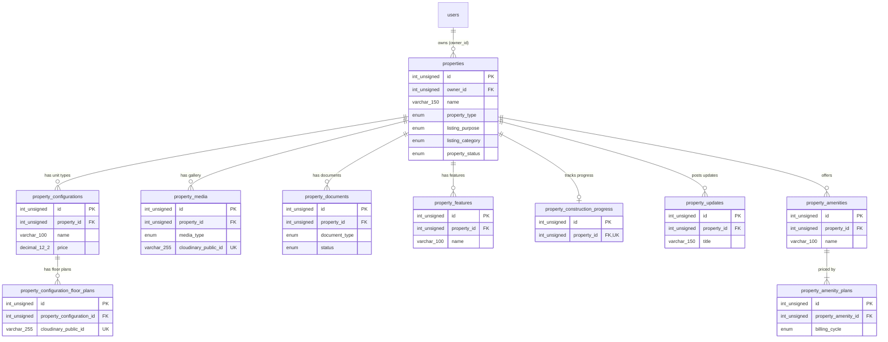

# Property – Database

Produced by `/db-design`, checked with `/db-design-review` on 2026-10-31 (second review after the answers, same day). Global view: `docs/database/SCHEMA.md`.

Status: **agreed** (grill, 2026-10-31); migrated on the property folder databases (`real_estate_property`, `real_estate_property_test`) on 2026-10-31. Migration: `backend/src/migrations/20261030212741-create-property-tables.cjs` (one file with every property table, so the property and staff branches can work in parallel). Models: `backend/src/models/property*.model.js`; enums `shared/src/enums/property.enums.js`; limits `LIMITS.property` in `shared/src/limits.js`.

Questions PROP-Q-001 to PROP-Q-032 are answered and their decisions (PROP-DEC-001 to PROP-DEC-023, [docs/execution/property/decisions/](../../execution/property/decisions/)) are final (grill with the user, 2026-10-31). Items marked with a question id below follow that answer. Open: PROP-Q-022 (staff access, for the staff module; no table change here).

Figma: file `iREXbZTABmZigGHBpTpOnz`, page "Property mangement module" (node `13009:7144`). Frame ids below are on that page; see [figma.md](figma.md).

## Scope

The property module owns the listing itself: the property, its configurations (unit types) and floor plans, media, documents, features, construction progress and updates, and bookable amenities with their price plans. The Property Detail tabs CRM, Payment, Buyers, Marketing and Facility, and the stat cards, show other modules' data and have **no table here** (PROP-Q-003); see "Figma items not mapped to a table".

## ERD

Foreign keys (all `ON UPDATE RESTRICT`):

| FK                                                              | From                                                           | To                           | ON DELETE                                                   |
| --------------------------------------------------------------- | -------------------------------------------------------------- | ---------------------------- | ----------------------------------------------------------- |
| `fk_properties_users`                                           | `properties.owner_id`                                          | `users.id` (auth)            | RESTRICT (PROP-DEC-001: an owner account cannot be deleted) |
| `fk_property_configurations_properties`                         | `property_configurations.property_id`                          | `properties.id`              | CASCADE (PROP-Q-002)                                        |
| `fk_property_configuration_floor_plans_property_configurations` | `property_configuration_floor_plans.property_configuration_id` | `property_configurations.id` | CASCADE                                                     |
| `fk_property_media_properties`                                  | `property_media.property_id`                                   | `properties.id`              | CASCADE                                                     |
| `fk_property_documents_properties`                              | `property_documents.property_id`                               | `properties.id`              | CASCADE                                                     |
| `fk_property_features_properties`                               | `property_features.property_id`                                | `properties.id`              | CASCADE                                                     |
| `fk_property_construction_progress_properties`                  | `property_construction_progress.property_id`                   | `properties.id`              | CASCADE                                                     |
| `fk_property_updates_properties`                                | `property_updates.property_id`                                 | `properties.id`              | CASCADE                                                     |
| `fk_property_amenities_properties`                              | `property_amenities.property_id`                               | `properties.id`              | CASCADE                                                     |
| `fk_property_amenity_plans_property_amenities`                  | `property_amenity_plans.property_amenity_id`                   | `property_amenities.id`      | CASCADE                                                     |

Incoming FK from another module: `staff_property_assignments.property_id` -> `properties.id` (staff, `ON DELETE CASCADE`). Later modules (leads, bookings, payments) are expected to reference `properties` with `ON DELETE RESTRICT` (PROP-DEC-002).

Deleting a user who owns properties is blocked (PROP-DEC-001): besides the RESTRICT FK, the auth user-deletion service counts the user's properties (and staff, in the staff module) inside its transaction and answers 409 CONFLICT with `authMessages.api.accountHasPropertiesOrStaff`.

CASCADE deletes rows only. Before deleting a property, configuration, update, media or document row, the service must queue every Cloudinary file of the rows that will go into `pending_file_deletions` in the same transaction (DEC-018).

## Conventions used in every table

- `id INT UNSIGNED AUTO_INCREMENT` PK; `created_at`, `updated_at` `DATETIME NOT NULL DEFAULT CURRENT_TIMESTAMP` (UTC, set by Sequelize); InnoDB, `utf8mb4` / `utf8mb4_unicode_ci`.
- Files follow DEC-016/DEC-018: `cloudinary_public_id VARCHAR(255) utf8mb4_bin` (unique), `cloudinary_resource_type`, `original_filename VARCHAR(255)`, `mime_type` ENUM, `size_bytes INT UNSIGNED`. No URL is stored; the backend signs delivery URLs. "File columns" below means these five.
- Required text has a CHECK `TRIM(col) <> ''` so a blank value cannot slip past the API.
- No soft delete (PROP-Q-002).

## Tables

### properties

Frames: add Property step 1 Basic Information (`13009:10644`), step 2 Property Details (`13009:10825`), step 6 Review & Submit (`13009:11344`); My Property cards (`13009:7145`); Property Detail header, Overview and Address (`13009:7369`); dropdowns Property Type (`13009:12418`), Listing purpose (`13009:12390`), Listing Category (`13009:12396`).

| Column           | Type                                                                     | Null | Default | Constraint                                 | Zod rule (shared, proposed)                        | Figma / notes                                                       |
| ---------------- | ------------------------------------------------------------------------ | ---- | ------- | ------------------------------------------ | -------------------------------------------------- | ------------------------------------------------------------------- |
| id               | INT UNSIGNED                                                             | no   | auto    | PK                                         | –                                                  |                                                                     |
| owner_id         | INT UNSIGNED                                                             | no   |         | FK `users.id` RESTRICT                     | – (from the session)                               | "My Properties" of the signed-in Developer. (PROP-Q-001)            |
| name             | VARCHAR(150)                                                             | no   |         | `chk_properties_name`                      | string, trim, min 1, max 150                       | "Property Name"                                                     |
| property_type    | ENUM(apartment, villa, studio, farmland, townhouse, plot, shops, duplex) | no   |         |                                            | `z.enum(PROPERTY_TYPES)`                           | "Property Type" dropdown (8 values)                                 |
| listing_purpose  | ENUM(sale, rent)                                                         | no   |         |                                            | `z.enum(LISTING_PURPOSES)`                         | "Listing Purpose": For Sale / For Rent                              |
| listing_category | ENUM(single_property, project)                                           | no   |         |                                            | `z.enum(LISTING_CATEGORIES)`                       | "Listing Category": Single Property / Project                       |
| property_status  | ENUM(ready_to_move, under_construction)                                  | no   |         |                                            | `z.enum(PROPERTY_STATUSES)`                        | "Property Status"; list (PROP-Q-004)                                |
| country_code     | CHAR(2)                                                                  | no   |         | `chk_properties_country_code` `^[A-Z]{2}$` | ISO 3166-1 alpha-2, upper case                     | "Country" (DEC-012 format). (PROP-Q-005)                            |
| state            | VARCHAR(100)                                                             | no   |         |                                            | string, trim, min 1, max 100                       | "State" / "State/county". text (PROP-Q-005)                         |
| city             | VARCHAR(100)                                                             | no   |         |                                            | string, trim, min 1, max 100                       | "City". text (PROP-Q-005)                                           |
| locality         | VARCHAR(150)                                                             | no   |         |                                            | string, trim, min 1, max 150                       | "Locality / Area"; card subtitle "Arera Colony, Bhopal"             |
| postal_code      | VARCHAR(10)                                                              | no   |         | `chk_properties_postal_code`               | regex `^[A-Za-z0-9][A-Za-z0-9 -]{1,8}[A-Za-z0-9]$` | "Pin / Postal code" (3 to 10 chars, letters, digits, space, hyphen) |
| address          | VARCHAR(255)                                                             | no   |         |                                            | string, trim, min 1, max 255                       | "Address" (Enter Full Address)                                      |
| latitude         | DECIMAL(8,6)                                                             | no   |         | `chk_properties_coordinates` (-90..90)     | number, -90..90, 6 decimals                        | "Pin Location on Map"; required (PROP-Q-014)                        |
| longitude        | DECIMAL(9,6)                                                             | no   |         | `chk_properties_coordinates` (-180..180)   | number, -180..180, 6 decimals                      | same                                                                |
| total_area       | DECIMAL(12,2)                                                            | no   |         | `chk_properties_total_area` > 0            | number > 0, 2 decimals                             | "Total Area" ("3 Acres")                                            |
| total_area_unit  | ENUM(sq_ft, acre)                                                        | no   |         |                                            | `z.enum(AREA_UNITS)`                               | (PROP-Q-006); needs a unit dropdown in the form                     |
| total_units      | INT UNSIGNED                                                             | no   |         | `chk_properties_counts` >= 1               | int >= 1                                           | "Total Units"                                                       |
| tower_count      | SMALLINT UNSIGNED                                                        | no   |         | `chk_properties_counts` >= 1               | int >= 1, max 65535                                | "No. of Towers / Blocks"                                            |
| floor_count      | SMALLINT UNSIGNED                                                        | no   |         | `chk_properties_counts` >= 1               | int >= 1, max 65535                                | "No. of Floors"                                                     |
| starting_price   | DECIMAL(12,2)                                                            | no   |         | `chk_properties_starting_price` > 0        | number > 0, 2 decimals, max 9999999999.99          | "Starting Price"; one currency (PROP-Q-007)                         |
| year_built       | SMALLINT UNSIGNED                                                        | no   |         | `chk_properties_year_built` 1800..2100     | int 1800..2100                                     | "Year Build"                                                        |
| builder_name     | VARCHAR(150)                                                             | no   |         |                                            | string, trim, min 1, max 150                       | "Developer / Builder Name"                                          |
| description      | TEXT                                                                     | no   |         |                                            | string, trim, min 1, max 5000                      | "Property Description"                                              |
| created_at       | DATETIME                                                                 | no   | now     |                                            | –                                                  | "Listed on: 22 Oct 2025"                                            |
| updated_at       | DATETIME                                                                 | no   | now     |                                            | –                                                  |                                                                     |

Indexes:

- `idx_properties_owner_id_created_at` (owner_id, created_at): My Properties list, newest first; serves the FK.
- `idx_properties_owner_id_name` (owner_id, name): "Search property" (name prefix) inside the owner's list.

Derived, not stored: "Type: 2-3BHK Apartment" (property type + configuration names), "Price Range: $840k - $1.4M" (min/max configuration price), "Units Sold / Units Rent", Leads, Booking, Enquiries, Visit (other modules, PROP-Q-003).

### property_configurations

Frames: Configuration tab cards and table (`13009:9932`), Add Configuration modal (`13009:10479`), add Property step 3 (`13009:10940`), Review (`13009:11344`).

| Column                 | Type                   | Null | Default | Constraint                                              | Zod rule (proposed)                                      | Figma / notes                                              |
| ---------------------- | ---------------------- | ---- | ------- | ------------------------------------------------------- | -------------------------------------------------------- | ---------------------------------------------------------- |
| id                     | INT UNSIGNED           | no   | auto    | PK                                                      | –                                                        |                                                            |
| property_id            | INT UNSIGNED           | no   |         | FK `properties.id` CASCADE                              | – (route param)                                          |                                                            |
| name                   | VARCHAR(100)           | no   |         | `chk_property_configurations_name`; unique per property | string, trim, min 1, max 100                             | "Configuration Name" / "Unit Type" ("2 BHK Apartment")     |
| area_sqft              | DECIMAL(10,2)          | no   |         | `chk_property_configurations_area` > 0                  | number > 0, 2 decimals, max 99999999.99                  | "Area (sq.ft)"                                             |
| price                  | DECIMAL(12,2)          | no   |         | `chk_property_configurations_price` > 0                 | number > 0, 2 decimals                                   | "Price"                                                    |
| total_units            | INT UNSIGNED           | no   |         | `chk_property_configurations_units` >= 1                | int >= 1                                                 | "Total Units"                                              |
| available_units        | INT UNSIGNED           | no   |         | `chk_property_configurations_units` <= total            | int >= 0, refine <= total_units (path `available_units`) | "Available Units"; "Available" badge = available_units > 0 |
| status                 | ENUM(active, inactive) | no   | active  |                                                         | `z.enum(CONFIGURATION_STATUSES)`                         | Status "Active". list (PROP-Q-009)                         |
| created_at, updated_at | DATETIME               | no   | now     |                                                         | –                                                        |                                                            |

Indexes: `uq_property_configurations_property_id_name` (property_id, name): one "2 BHK" per property (PROP-Q-014); serves the FK and the configuration list.

Not modelled: the hidden "Type" select of Add Configuration (PROP-Q-009). The sum of configuration units is not tied to `properties.total_units` (the designs show different numbers).

### property_configuration_floor_plans

Frames: "Floor plan & layout" with several files and an Upload tile (`13009:9932`); "Floor Plan Upload" (`13009:10479`, `13009:10940`).

| Column                    | Type                                         | Null | Default | Constraint                              | Zod rule (proposed)           | Notes                |
| ------------------------- | -------------------------------------------- | ---- | ------- | --------------------------------------- | ----------------------------- | -------------------- |
| id                        | INT UNSIGNED                                 | no   | auto    | PK                                      | –                             |                      |
| property_configuration_id | INT UNSIGNED                                 | no   |         | FK `property_configurations.id` CASCADE | –                             |                      |
| cloudinary_public_id      | VARCHAR(255) utf8mb4_bin                     | no   |         | unique                                  | – (server generated)          |                      |
| cloudinary_resource_type  | ENUM(image, raw)                             | no   |         | `..._resource_type`: PDF <=> raw        | –                             |                      |
| original_filename         | VARCHAR(255)                                 | no   |         |                                         | max 255                       | "2BHK_Floorplan.png" |
| mime_type                 | ENUM(application/pdf, image/jpeg, image/png) | no   |         |                                         | file type check (magic bytes) | "PDF, JPG, PNG"      |
| size_bytes                | INT UNSIGNED                                 | no   |         | `..._size` 1..10485760                  | max 10 MB                     | "Max size: 10 MB"    |
| created_at, updated_at    | DATETIME                                     | no   | now     |                                         | –                             |                      |

CHECKs: `chk_property_configuration_floor_plans_size`, `chk_property_configuration_floor_plans_resource_type`. Indexes: `uq_property_configuration_floor_plans_cloudinary_public_id`; `idx_property_configuration_floor_plans_config_id_created_at` (FK + list in upload order).

### property_media

Frames: add Property step 4 Upload Media (`13009:11051`), Gallery and "upload" tile (`13009:7369`, `13009:7612`), Upload image or video modal (`13009:12032`), full-screen viewer (`13009:12356`), card cover image (`13009:7145`).

| Column                   | Type                                   | Null | Default | Constraint                                                     | Zod rule (proposed)            | Notes                                                     |
| ------------------------ | -------------------------------------- | ---- | ------- | -------------------------------------------------------------- | ------------------------------ | --------------------------------------------------------- |
| id                       | INT UNSIGNED                           | no   | auto    | PK                                                             | –                              |                                                           |
| property_id              | INT UNSIGNED                           | no   |         | FK `properties.id` CASCADE                                     | –                              |                                                           |
| media_type               | ENUM(image, video, tour_360)           | no   |         |                                                                | `z.enum(MEDIA_TYPES)`          | "Property Images", "Videos", "360° Tour"                  |
| cloudinary_public_id     | VARCHAR(255) utf8mb4_bin               | no   |         | unique                                                         | –                              |                                                           |
| cloudinary_resource_type | ENUM(image, video)                     | no   |         | `chk_property_media_resource_type`: image <=> media_type image | –                              | `video` needs PROP-Q-011 for cleanup                      |
| original_filename        | VARCHAR(255)                           | no   |         |                                                                | max 255                        |                                                           |
| mime_type                | ENUM(image/jpeg, image/png, video/mp4) | no   |         | `chk_property_media_mime_type`                                 | file type check                | Images JPG/PNG, videos MP4. (PROP-Q-016)                  |
| size_bytes               | INT UNSIGNED                           | no   |         | `chk_property_media_size`                                      | image <= 10 MB, video <= 40 MB | "Max size: 10 MB" / "40 MB"                               |
| sort_order               | SMALLINT UNSIGNED                      | no   | 0       |                                                                | int >= 0                       | Gallery order ("2/12"); first image = cover. (PROP-Q-016) |
| created_at, updated_at   | DATETIME                               | no   | now     |                                                                | –                              |                                                           |

Indexes: `uq_property_media_cloudinary_public_id`; `idx_property_media_property_id_type_sort_order` (gallery in order, cover image; serves the FK).

### property_documents

Frames: add Property step 5 Documents (`13009:11196`), Documents tab with filters All Status / All Category and View / Download / Replace (`13009:10202`), Replace Document modal (`13009:12013`).

| Column                 | Type                                                                                       | Null | Default  | Constraint                                                            | Zod rule (proposed)               | Notes                                                                                |
| ---------------------- | ------------------------------------------------------------------------------------------ | ---- | -------- | --------------------------------------------------------------------- | --------------------------------- | ------------------------------------------------------------------------------------ |
| id                     | INT UNSIGNED                                                                               | no   | auto     | PK                                                                    | –                                 |                                                                                      |
| property_id            | INT UNSIGNED                                                                               | no   |          | FK `properties.id` CASCADE                                            | –                                 |                                                                                      |
| document_type          | ENUM(rera_certificate, floor_plan, legal_noc, ownership_proof, financial_statement, other) | no   |          |                                                                       | `z.enum(PROPERTY_DOCUMENT_TYPES)` | Upload slots; category (Legal, Financial, Architecture, Other) derived. (PROP-Q-010) |
| status                 | ENUM(uploaded, pending, verified)                                                          | no   | uploaded |                                                                       | – (server set)                    | Badges Uploaded / Pending / Verified. workflow (PROP-Q-010)                          |
| file columns           | as floor plans (PDF/JPG/PNG, 10 MB)                                                        | no   |          | `chk_property_documents_size`, `chk_property_documents_resource_type` | max 10 MB                         | "Rera_Certificate.pdf, Size: 4.54 mb"                                                |
| created_at, updated_at | DATETIME                                                                                   | no   | now      |                                                                       | –                                 |                                                                                      |

Indexes: `uq_property_documents_cloudinary_public_id`; `idx_property_documents_property_id_document_type` ("All Category" filter, serves the FK); `idx_property_documents_property_id_status` ("All Status" filter).

### property_features

Frames: "Amenities" input of step 2 (`13009:10825`), Review "Swimming Pool, Gym, Lift, 24x7 Water Supply" (`13009:11344`), "Amenities & Features" list (`13009:7369`).

| Column                 | Type         | Null | Default | Constraint                                        | Zod rule (proposed)                                       | Notes        |
| ---------------------- | ------------ | ---- | ------- | ------------------------------------------------- | --------------------------------------------------------- | ------------ |
| id                     | INT UNSIGNED | no   | auto    | PK                                                | –                                                         |              |
| property_id            | INT UNSIGNED | no   |         | FK `properties.id` CASCADE                        | –                                                         |              |
| name                   | VARCHAR(100) | no   |         | `chk_property_features_name`; unique per property | array of string, trim, min 1, max 100 each, no duplicates | (PROP-Q-008) |
| created_at, updated_at | DATETIME     | no   | now     |                                                   | –                                                         |              |

Indexes: `uq_property_features_property_id_name` (serves the FK).

### property_construction_progress

One row per under-construction property. Frames: Project Overview card (`13009:7876`), Update Progress modal (`13009:10526`), "65% complete" bar on the card (`13009:7145`).

| Column                 | Type             | Null | Default | Constraint                                          | Zod rule (proposed) | Notes                                                        |
| ---------------------- | ---------------- | ---- | ------- | --------------------------------------------------- | ------------------- | ------------------------------------------------------------ |
| id                     | INT UNSIGNED     | no   | auto    | PK                                                  | –                   |                                                              |
| property_id            | INT UNSIGNED     | no   |         | FK `properties.id` CASCADE, unique                  | –                   |                                                              |
| overall_percent        | TINYINT UNSIGNED | no   | 0       | `chk_property_construction_progress_percent` <= 100 | int 0..100          | "Overall Progress" (entered, PROP-Q-013)                     |
| foundation_percent     | TINYINT UNSIGNED | no   | 0       | same                                                | int 0..100          | "Foundation"; badge derived (100 Complete, 1-99 In progress) |
| structure_percent      | TINYINT UNSIGNED | no   | 0       | same                                                | int 0..100          | "Structure"                                                  |
| interior_percent       | TINYINT UNSIGNED | no   | 0       | same                                                | int 0..100          | "Interior"                                                   |
| finishing_percent      | TINYINT UNSIGNED | no   | 0       | same                                                | int 0..100          | "Finishing"                                                  |
| possession_date        | DATE             | yes  | NULL    |                                                     | date, optional      | "Possession Date: Dec 2026"; no input designed (PROP-Q-013)  |
| created_at, updated_at | DATETIME         | no   | now     |                                                     | –                   |                                                              |

Indexes: `uq_property_construction_progress_property_id` (1:1, serves the FK). The service creates the row when a property is (or becomes) `under_construction`.

### property_updates

Frames: Updates list with title, text and date, "Add Update" (`13009:7876`; card button on `13009:7145`), Add Update modal (`13009:10615`).

| Column       | Type                         | Null | Default | Constraint                                                                           | Zod rule (proposed)                   | Notes                                                                                              |
| ------------ | ---------------------------- | ---- | ------- | ------------------------------------------------------------------------------------ | ------------------------------------- | -------------------------------------------------------------------------------------------------- |
| id           | INT UNSIGNED                 | no   | auto    | PK                                                                                   | –                                     |                                                                                                    |
| property_id  | INT UNSIGNED                 | no   |         | FK `properties.id` CASCADE                                                           | –                                     |                                                                                                    |
| title        | VARCHAR(150)                 | no   |         | `chk_property_updates_text`                                                          | string, trim, min 1, max 150          | "Title"                                                                                            |
| description  | VARCHAR(2000)                | no   |         | `chk_property_updates_text`                                                          | string, trim, min 1, max 2000         | "Description"                                                                                      |
| file columns | as floor plans, all nullable | yes  | NULL    | `chk_property_updates_file_all_or_none`, `_size`, `_resource_type`; unique public id | optional file, PDF/JPG/PNG, max 10 MB | "Upload Image (optional)"; JPG/PNG only through the API (PROP-DEC-011); the column also allows PDF |
| created_at   | DATETIME                     | no   | now     |                                                                                      | –                                     | Shown date ("16 Feb 2025")                                                                         |
| updated_at   | DATETIME                     | no   | now     |                                                                                      | –                                     |                                                                                                    |

Indexes: `uq_property_updates_cloudinary_public_id` (NULLs allowed); `idx_property_updates_property_id_created_at` (list newest first; serves the FK).

### property_amenities

Bookable amenities ("New Feature"). Frames: Amenity tab with filters All Status / All Amenities (`13009:8335`), Add Amenities Detail (`13009:11821`), Edit Gym Amenities Detail (`13009:11898`), Delete GYM Amenity "permanent" (`13009:12402`), success "New amenity added" (`13009:11589`).

| Column                 | Type                           | Null | Default | Constraint                                         | Zod rule (proposed)             | Notes                                  |
| ---------------------- | ------------------------------ | ---- | ------- | -------------------------------------------------- | ------------------------------- | -------------------------------------- |
| id                     | INT UNSIGNED                   | no   | auto    | PK                                                 | –                               |                                        |
| property_id            | INT UNSIGNED                   | no   |         | FK `properties.id` CASCADE                         | –                               |                                        |
| name                   | VARCHAR(100)                   | no   |         | `chk_property_amenities_name`; unique per property | string, trim, min 1, max 100    | "Amenity Name" (free text, PROP-Q-012) |
| category               | ENUM(sports, event, parking)   | no   |         |                                                    | `z.enum(AMENITY_CATEGORIES)`    | List "Category" column. (PROP-Q-012)   |
| pricing_type           | ENUM(subscription, time_based) | no   |         |                                                    | `z.enum(AMENITY_PRICING_TYPES)` | List "Type": Monthly / Time Based      |
| description            | VARCHAR(1000)                  | no   |         |                                                    | string, trim, min 1, max 1000   | "Amenity Description"                  |
| features               | VARCHAR(1000)                  | no   |         |                                                    | string, trim, min 1, max 1000   | "Amenity Features"                     |
| status                 | ENUM(active, inactive)         | no   | active  |                                                    | `z.enum(AMENITY_STATUSES)`      | Status "Active". (PROP-Q-012)          |
| created_at, updated_at | DATETIME                       | no   | now     |                                                    | –                               |                                        |

Indexes: `uq_property_amenities_property_id_name` (unique name per property; serves the FK and name search); `idx_property_amenities_property_id_status` ("All Status").

### property_amenity_plans

Frames: "Subscription" block with Plan, Billing Cycle, Price, Feature (`13009:11821`, `13009:11898`); list "Pricing" "$100", "$10hr/ $40day" (`13009:8335`).

| Column                 | Type                   | Null | Default | Constraint                              | Zod rule (proposed)              | Notes                                                                  |
| ---------------------- | ---------------------- | ---- | ------- | --------------------------------------- | -------------------------------- | ---------------------------------------------------------------------- |
| id                     | INT UNSIGNED           | no   | auto    | PK                                      | –                                |                                                                        |
| property_amenity_id    | INT UNSIGNED           | no   |         | FK `property_amenities.id` CASCADE      | –                                |                                                                        |
| plan_name              | VARCHAR(50)            | no   |         | `chk_property_amenity_plans_plan_name`  | string, trim, min 1, max 50      | "Plan" ("Basic")                                                       |
| billing_cycle          | ENUM(hour, day, month) | no   |         |                                         | `z.enum(AMENITY_BILLING_CYCLES)` | "Billing Cycle" ("Month"); hour/day from "$10hr/ $40day". (PROP-Q-012) |
| price                  | DECIMAL(12,2)          | no   |         | `chk_property_amenity_plans_price` >= 0 | number >= 0, 2 decimals          | "Price"                                                                |
| features               | VARCHAR(255)           | yes  | NULL    |                                         | string, trim, max 255, optional  | "Feature". Optional (PROP-Q-012; a time-based price has none)          |
| created_at, updated_at | DATETIME               | no   | now     |                                         | –                                |                                                                        |

Indexes: `uq_property_amenity_plans_amenity_id_plan_name_cycle` (one price per plan and cycle; serves the FK). An amenity must have at least one plan: enforced in the service (the DB cannot require a child row).

## Figma items not mapped to a table

- Other modules' data on Property Detail (PROP-Q-003): CRM leads table and lead detail, lead statuses New / Contacted / Site Visit Scheduled / Approved for Visit / Visited / Deal Finalized / Closed (`13009:8095`, `13009:12076`, dropdown `13009:10782`); payments table and payment detail with installments (`13009:8592`, `13009:12138`, status dropdown `13009:10805`); Buyers tab, booking detail and installment tracker (`13009:8847`, `13009:12212`); Marketing posts (`13009:9120`); Facility tasks, facility company, Reassign / Add New Company and their success modals (`13009:9388`, `13009:9660`, `13009:11609`, `13009:11979`, `13009:11643`, `13009:11779`, `13009:11569`, `13009:11579`); configuration filter "Show All / 2BHK / 3BHK / Overdue" used by those tabs (`13009:12051`).
- Stat cards and counters: Total Units "Units Listed", Total Earnings, Active Leads, Visit, "growth this month", Enquiries, Booking, Units Sold / Units Rent (`13009:7145`, `13009:7369`). Computed by other modules or analytics.
- The map image (rendered from `latitude` / `longitude`).
- Hidden layers: the Add Configuration "Type" select, the amenity "Amenity Type" and "Upload Amenity Image" fields, and the header "Status: Ready to move" row.

## Personal data and retention

- `properties.owner_id`: links the listing to an account (personal data lives in `users`, see `docs/modules/auth/db.md`). Kept while the property exists; the account cannot be deleted while it owns properties (PROP-DEC-001).
- `properties.builder_name`, address and coordinates describe a building or a business, not a person. If a Single Property is a private home, its address is personal data of the owner: kept while the listing exists and deleted with it (PROP-Q-002).
- `original_filename` on file tables may contain a name ("Rera_Certificate.pdf"); documents such as ownership proof may contain personal data. Files are private Cloudinary assets (DEC-016), deleted through `pending_file_deletions` when their row is deleted (DEC-018).

## Answers, decisions and open items

Answers and their decisions (confirmed by the user in the grill, 2026-10-31; PROP-DEC-011 to PROP-DEC-023 add API and UI rules, no table change):

| Question                                                           | Decision                                  |
| ------------------------------------------------------------------ | ----------------------------------------- |
| PROP-Q-001 owner                                                   | PROP-DEC-001 (plus: owner delete blocked) |
| PROP-Q-002 delete                                                  | PROP-DEC-002                              |
| PROP-Q-003 scope                                                   | PROP-DEC-003                              |
| PROP-Q-004 status, Q-005 location, Q-006 area unit, Q-007 currency | PROP-DEC-004                              |
| PROP-Q-014 required/unique, Q-015 drafts                           | PROP-DEC-005                              |
| PROP-Q-008 features, Q-012 bookable amenities                      | PROP-DEC-006                              |
| PROP-Q-009 configuration status/type                               | PROP-DEC-007                              |
| PROP-Q-010 documents                                               | PROP-DEC-008                              |
| PROP-Q-011 video cleanup, Q-016 media rules                        | PROP-DEC-009                              |
| PROP-Q-013 construction progress                                   | PROP-DEC-010                              |

Follow-ups (not in this module's migration):

- `pending_file_deletions.resource_type` needs `'video'`, plus video support in `cloudinaryStorage` (PROP-Q-011, PROP-DEC-009). Done in feature/property as a new additive migration (PROP-DEC-013), in its own ticket before media upload. Until then no video or 360 tour may be uploaded: a property delete would try to queue a `video` file and fail.
- Account deletion: the 409 check lives in the auth user-deletion service (PROP-DEC-001, done). A MySQL integration test of the 409 case is still to add.

Open:

- PROP-Q-022: staff access to properties (staff module). Answered PROP-Q-017: update images JPG/PNG only (PROP-DEC-011).

Service rules the DB cannot enforce (to cover in the spec and tests): an amenity has at least one plan; which billing cycles fit each pricing type; the progress row exists only for under-construction properties (and what happens to it when the status changes back); required document slots on submit; gallery order ties are broken by `id`; only the owner's properties are assigned to its staff.

Buyer-side search (city, price range, type) is not designed yet; its indexes (for example `(city, property_type)`) are added with that feature.
