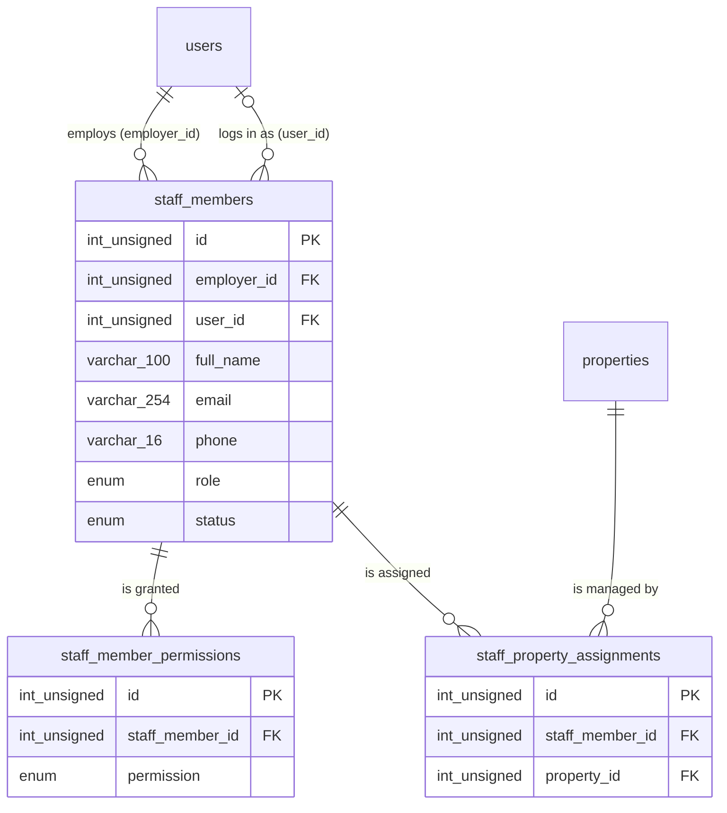

# Staff – Database

Produced by `/db-design`, checked with `/db-design-review` on 2026-10-31 (second review after the answers, same day). Global view: `docs/database/SCHEMA.md`.

Status: **migrated** on this folder's `real_estate_staff` and `real_estate_staff_test` (2026-10-31); not merged into `testing`. The grill of 2026-10-31 (STAFF-Q-009 to STAFF-Q-022) changed no table. Migration: `backend/src/migrations/20261030212742-create-staff-tables.cjs` (one file with every staff table). Models: `backend/src/models/staff*.model.js`; enums `shared/src/enums/staff.enums.js`; limits `LIMITS.staff` in `shared/src/limits.js`.

Questions STAFF-Q-001 to STAFF-Q-008 in [docs/execution/staff/questions/](../../execution/staff/questions/) were answered on 2026-10-31 with their recommended option and confirmed final by the user the same day (STAFF-Q-010). The exception is the deletion rule of STAFF-Q-007: the user decided to **block** deleting an account that employs staff (`ON DELETE RESTRICT`, [PROP-DEC-001](../../execution/property/decisions/PROP-DEC-001-block-deleting-owner-accounts.md)). Decisions: STAFF-DEC-001 to STAFF-DEC-006 in [docs/execution/staff/decisions/](../../execution/staff/decisions/).

Figma: file `iREXbZTABmZigGHBpTpOnz`, page "Staff management module" (node `13009:17815`). See [figma.md](figma.md).

## Dependencies on other modules

- `users` (auth): `staff_members.employer_id` and `staff_members.user_id`, both `INT UNSIGNED` like `users.id`. The auth user-deletion service refuses (409) to delete an account that employs staff (PROP-DEC-001).
- `properties` (property): `staff_property_assignments.property_id`. This is the **only** cross-module FK. The staff migration has a later timestamp than `20261030212741-create-property-tables.cjs`, so the `feature/staff` branch must contain that property migration file (merge or cherry-pick it from `feature/property`) before it runs `db:migrate`.
- No change to `user_roles`. Staff log in (STAFF-DEC-001), so a new account role value is needed there: a follow-up for the auth / integration owner.

## ERD

Foreign keys (all `ON UPDATE RESTRICT`):

| FK                                            | From                                         | To                             | ON DELETE                                                      |
| --------------------------------------------- | -------------------------------------------- | ------------------------------ | -------------------------------------------------------------- |
| `fk_staff_members_employer_users`             | `staff_members.employer_id`                  | `users.id` (auth)              | RESTRICT (PROP-DEC-001: an employer account cannot be deleted) |
| `fk_staff_members_users`                      | `staff_members.user_id`                      | `users.id` (auth)              | SET NULL (STAFF-Q-001)                                         |
| `fk_staff_member_permissions_staff_members`   | `staff_member_permissions.staff_member_id`   | `staff_members.id`             | CASCADE (STAFF-Q-004)                                          |
| `fk_staff_property_assignments_staff_members` | `staff_property_assignments.staff_member_id` | `staff_members.id`             | CASCADE (STAFF-Q-004)                                          |
| `fk_staff_property_assignments_properties`    | `staff_property_assignments.property_id`     | `properties.id` (**property**) | CASCADE (STAFF-Q-006)                                          |

## Tables

### staff_members

Frames: Staff Management list (`13009:17816`: Name, Role, Email, Phone, Status, View / Edit / Remove), Add Staff (`13009:18190`: Full Name, Email, Phone Number, Role, Assign Access Permissions), staff Detail (`13009:18226`: name, role, status dropdown, Edit, Remove Staff, phone, email, status), success "Your new staff has been added" (`13009:18180`).

| Column                 | Type                   | Null | Default | Constraint                                               | Zod rule (shared, proposed)                                                       | Figma / notes                                          |
| ---------------------- | ---------------------- | ---- | ------- | -------------------------------------------------------- | --------------------------------------------------------------------------------- | ------------------------------------------------------ |
| id                     | INT UNSIGNED           | no   | auto    | PK                                                       | –                                                                                 |                                                        |
| employer_id            | INT UNSIGNED           | no   |         | FK `users.id` RESTRICT                                   | – (from the session)                                                              | The Active developer who added the member. STAFF-Q-007 |
| user_id                | INT UNSIGNED           | yes  | NULL    | FK `users.id` SET NULL                                   | – (server set)                                                                    | The member's own login, once invited. STAFF-Q-001      |
| full_name              | VARCHAR(100)           | no   |         | `chk_staff_members_full_name`                            | same rule as auth `fullName` (trim, min 2, max 100; `LIMITS.staff.fullName`)      | "Full Name" / "Name"                                   |
| email                  | VARCHAR(254)           | no   |         | `chk_staff_members_email_lowercase`; unique per employer | same rule as auth `email` (trim, lowercase, max 254, email; `LIMITS.staff.email`) | "Email". Unique per employer, STAFF-Q-005              |
| phone                  | VARCHAR(16)            | no   |         | `chk_staff_members_phone_e164` `^[+][1-9][0-9]{6,14}$`   | same rule as auth `phone` (E.164, max 16; `LIMITS.staff.phone`)                   | "Phone Number" ("+91 7485961245")                      |
| role                   | ENUM(agent)            | no   |         |                                                          | `z.enum(STAFF_ROLES)`                                                             | "Role" ("Agent"). List STAFF-Q-002                     |
| status                 | ENUM(active, disabled) | no   | active  |                                                          | `z.enum(STAFF_STATUSES)`                                                          | "Active" / "Disable"; changed from the Detail dropdown |
| created_at, updated_at | DATETIME               | no   | now     |                                                          | –                                                                                 |                                                        |

Indexes:

- `uq_staff_members_employer_id_email` (employer_id, email): one record per person per employer; serves the FK on `employer_id`.
- `idx_staff_members_employer_id_created_at` (employer_id, created_at): Staff List, newest first.
- `idx_staff_members_user_id` (user_id): find the staff records of a logged-in account; serves the FK.

`user_id` has no CHECK on purpose: MySQL rejects a CHECK on a column written by an `ON DELETE SET NULL` FK. So "a developer does not add their own account as staff" and "one account is linked once per employer" are not DB rules; they are decided with the invitation flow (STAFF-DEC-001 follow-up).

### staff_member_permissions

Frames: "Assign Access Permissions" (`13009:18190`), "Assigned Permissions / Access" with tick / cross per area (`13009:18226`).

| Column                 | Type                                                                                     | Null | Default | Constraint                    | Zod rule (proposed)                                 | Notes                                    |
| ---------------------- | ---------------------------------------------------------------------------------------- | ---- | ------- | ----------------------------- | --------------------------------------------------- | ---------------------------------------- |
| id                     | INT UNSIGNED                                                                             | no   | auto    | PK                            | –                                                   |                                          |
| staff_member_id        | INT UNSIGNED                                                                             | no   |         | FK `staff_members.id` CASCADE | –                                                   |                                          |
| permission             | ENUM(properties_management, leads_crm, payment_tracking, marketing, facility_management) | no   |         | unique per staff member       | array of `z.enum(STAFF_PERMISSIONS)`, no duplicates | The five areas. Multi-select STAFF-Q-003 |
| created_at, updated_at | DATETIME                                                                                 | no   | now     |                               | –                                                   |                                          |

Indexes: `uq_staff_member_permissions_staff_member_id_permission` (serves the FK). An area without a row is shown with the red cross.

### staff_property_assignments

Frames: "Assigned Property" card and "Assign Property" button (`13009:18226`).

| Column                 | Type         | Null | Default | Constraint                                | Zod rule (proposed)     | Notes                                                                   |
| ---------------------- | ------------ | ---- | ------- | ----------------------------------------- | ----------------------- | ----------------------------------------------------------------------- |
| id                     | INT UNSIGNED | no   | auto    | PK                                        | –                       |                                                                         |
| staff_member_id        | INT UNSIGNED | no   |         | FK `staff_members.id` CASCADE             | – (route param)         |                                                                         |
| property_id            | INT UNSIGNED | no   |         | FK `properties.id` CASCADE (cross-module) | int >= 1 (`propertyId`) | Must be one of the employer's own properties: service rule, STAFF-Q-006 |
| created_at, updated_at | DATETIME     | no   | now     |                                           | –                       |                                                                         |

Indexes: `uq_staff_property_assignments_staff_member_id_property_id` (no duplicate assignment; serves the FK on `staff_member_id`); `idx_staff_property_assignments_property_id` (staff of a property; serves the FK on `property_id`).

Models: `StaffMember.belongsToMany(Property, { through: StaffPropertyAssignment, as: 'assignedProperties' })` and the reverse `Property.staffMembers`; `StaffMember.employer` and `StaffMember.user` (both `User`); `StaffMember.permissions`.

## Figma items not mapped to a table

- Avatar photo on the Detail and list: no upload field in any frame (initials or a placeholder until one is designed).
- On the Assigned Property card: property name, location, cover image and "Ready to move" come from `properties`; the second "Active" status and "8 Leads Assigned" are not staff data (property state and CRM leads, STAFF-Q-006).
- Hidden layers on the Staff Management frame (a stepper copied from Add Property, a "What Can we help with?" support block): not part of this module.

## Personal data and retention

- `staff_members.full_name`, `email`, `phone`: personal data of a third person, entered by the developer. Needed to identify and contact the staff member (and to invite them, STAFF-DEC-001). Kept while the record exists and deleted with it on Remove; never logged. The employer account cannot be deleted while it has staff (PROP-DEC-001), so the records are removed first; nothing is kept after removal. (STAFF-Q-008, STAFF-DEC-003).
- `staff_members.user_id`: links to the member's own account (personal data in `users`, auth module). Set to NULL if that account is deleted.

## Answers, decisions and open items

| Question                                       | Decision                                        |
| ---------------------------------------------- | ----------------------------------------------- |
| STAFF-Q-001 accounts and login                 | STAFF-DEC-001                                   |
| STAFF-Q-002 role list, STAFF-Q-003 permissions | STAFF-DEC-002                                   |
| STAFF-Q-004 remove, STAFF-Q-008 retention      | STAFF-DEC-003                                   |
| STAFF-Q-005 uniqueness                         | STAFF-DEC-004                                   |
| STAFF-Q-006 property assignment                | STAFF-DEC-005                                   |
| STAFF-Q-007 employer and its deletion          | STAFF-DEC-006 (deletion rule from PROP-DEC-001) |

Follow-up for the integration owner: a staff login role in `user_roles.role` and `USER_ROLES`, plus the invitation flow (STAFF-DEC-001). Not changed here.

Role list: only "Agent" (STAFF-Q-010 confirmed it); adding a role is a small migration plus `STAFF_ROLES`.

In this build nothing writes `staff_members.user_id` (records only, STAFF-DEC-007); the module reads `properties` and `property_media` read-only to list and show assignable properties (STAFF-DEC-009).
