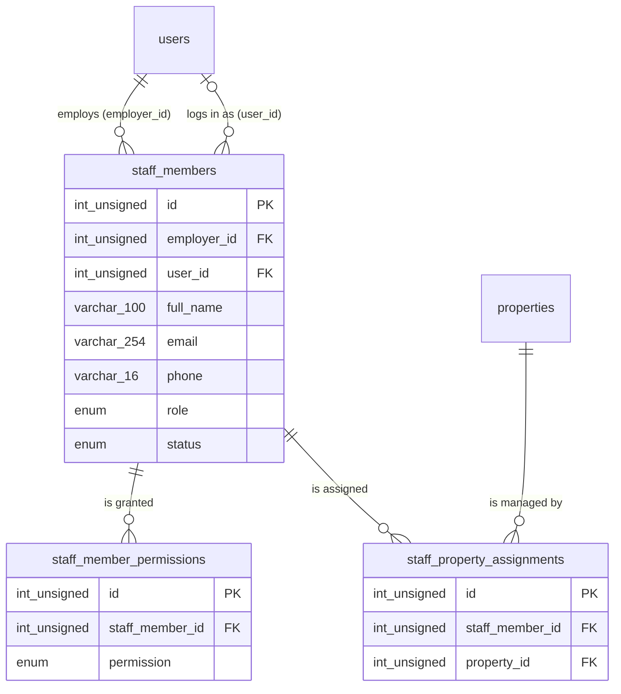

# Staff – Database

Produced by `/db-design`, checked with `/db-design-review` on 2026-10-31. Global view: `docs/database/SCHEMA.md`.

Status: **DRAFT**, not approved and not migrated on any database. Migration: `backend/src/migrations/20261030212742-create-staff-tables.cjs` (one file with every staff table). Open questions: STAFF-Q-001 to STAFF-Q-008 in [docs/execution/staff/questions/](../../execution/staff/questions/). Every item marked **ASSUMED** below is the recommended option of the question it cites and is reversible.

Figma: file `iREXbZTABmZigGHBpTpOnz`, page "Staff management module" (node `13009:17815`). See [figma.md](figma.md).

## Dependencies on other modules

- `users` (auth): `staff_members.employer_id` and `staff_members.user_id`, both `INT UNSIGNED` like `users.id`.
- `properties` (property): `staff_property_assignments.property_id`. This is the **only** cross-module FK. The staff migration has a later timestamp than `20261030212741-create-property-tables.cjs`, so the `feature/staff` branch must contain that property migration file (merge or cherry-pick it from `feature/property`) before it runs `db:migrate`.
- No change to `user_roles`. If staff log in, a new role value is needed there (STAFF-Q-001), owned by the auth / integration owner.

## ERD

Foreign keys (all `ON UPDATE RESTRICT`):

| FK                                            | From                                         | To                             | ON DELETE                       |
| --------------------------------------------- | -------------------------------------------- | ------------------------------ | ------------------------------- |
| `fk_staff_members_employer_users`             | `staff_members.employer_id`                  | `users.id` (auth)              | CASCADE (ASSUMED, STAFF-Q-007)  |
| `fk_staff_members_users`                      | `staff_members.user_id`                      | `users.id` (auth)              | SET NULL (ASSUMED, STAFF-Q-001) |
| `fk_staff_member_permissions_staff_members`   | `staff_member_permissions.staff_member_id`   | `staff_members.id`             | CASCADE (STAFF-Q-004)           |
| `fk_staff_property_assignments_staff_members` | `staff_property_assignments.staff_member_id` | `staff_members.id`             | CASCADE (STAFF-Q-004)           |
| `fk_staff_property_assignments_properties`    | `staff_property_assignments.property_id`     | `properties.id` (**property**) | CASCADE (ASSUMED, STAFF-Q-006)  |

## Tables

### staff_members

Frames: Staff Management list (`13009:17816`: Name, Role, Email, Phone, Status, View / Edit / Remove), Add Staff (`13009:18190`: Full Name, Email, Phone Number, Role, Assign Access Permissions), staff Detail (`13009:18226`: name, role, status dropdown, Edit, Remove Staff, phone, email, status), success "Your new staff has been added" (`13009:18180`).

| Column                 | Type                   | Null | Default | Constraint                                               | Zod rule (shared, proposed)                               | Figma / notes                                               |
| ---------------------- | ---------------------- | ---- | ------- | -------------------------------------------------------- | --------------------------------------------------------- | ----------------------------------------------------------- |
| id                     | INT UNSIGNED           | no   | auto    | PK                                                       | –                                                         |                                                             |
| employer_id            | INT UNSIGNED           | no   |         | FK `users.id` CASCADE                                    | – (from the session)                                      | The Developer who added the member. ASSUMED (STAFF-Q-007)   |
| user_id                | INT UNSIGNED           | yes  | NULL    | FK `users.id` SET NULL                                   | – (server set)                                            | The member's own login, once invited. ASSUMED (STAFF-Q-001) |
| full_name              | VARCHAR(100)           | no   |         | `chk_staff_members_full_name`                            | reuse auth `fullName` rule (trim, min 1, max 100)         | "Full Name" / "Name"                                        |
| email                  | VARCHAR(254)           | no   |         | `chk_staff_members_email_lowercase`; unique per employer | reuse auth `email` rule (trim, lowercase, max 254, email) | "Email". Unique per employer ASSUMED (STAFF-Q-005)          |
| phone                  | VARCHAR(16)            | no   |         | `chk_staff_members_phone_e164` `^[+][1-9][0-9]{6,14}$`   | reuse auth `phone` rule (E.164, max 16)                   | "Phone Number" ("+91 7485961245")                           |
| role                   | ENUM(agent)            | no   |         |                                                          | `z.enum(STAFF_ROLES)`                                     | "Role" ("Agent"). List ASSUMED (STAFF-Q-002)                |
| status                 | ENUM(active, disabled) | no   | active  |                                                          | `z.enum(STAFF_STATUSES)`                                  | "Active" / "Disable"; changed from the Detail dropdown      |
| created_at, updated_at | DATETIME               | no   | now     |                                                          | –                                                         |                                                             |

Indexes:

- `uq_staff_members_employer_id_email` (employer_id, email): one record per person per employer; serves the FK on `employer_id`.
- `idx_staff_members_employer_id_created_at` (employer_id, created_at): Staff List, newest first.
- `idx_staff_members_user_id` (user_id): find the staff records of a logged-in account; serves the FK.

`user_id` has no CHECK on purpose: MySQL rejects a CHECK on a column written by an `ON DELETE SET NULL` FK.

### staff_member_permissions

Frames: "Assign Access Permissions" (`13009:18190`), "Assigned Permissions / Access" with tick / cross per area (`13009:18226`).

| Column                 | Type                                                                                     | Null | Default | Constraint                    | Zod rule (proposed)                                 | Notes                                              |
| ---------------------- | ---------------------------------------------------------------------------------------- | ---- | ------- | ----------------------------- | --------------------------------------------------- | -------------------------------------------------- |
| id                     | INT UNSIGNED                                                                             | no   | auto    | PK                            | –                                                   |                                                    |
| staff_member_id        | INT UNSIGNED                                                                             | no   |         | FK `staff_members.id` CASCADE | –                                                   |                                                    |
| permission             | ENUM(properties_management, leads_crm, payment_tracking, marketing, facility_management) | no   |         | unique per staff member       | array of `z.enum(STAFF_PERMISSIONS)`, no duplicates | The five areas. Multi-select ASSUMED (STAFF-Q-003) |
| created_at, updated_at | DATETIME                                                                                 | no   | now     |                               | –                                                   |                                                    |

Indexes: `uq_staff_member_permissions_staff_member_id_permission` (serves the FK). An area without a row is shown with the red cross.

### staff_property_assignments

Frames: "Assigned Property" card and "Assign Property" button (`13009:18226`).

| Column                 | Type         | Null | Default | Constraint                                | Zod rule (proposed)     | Notes                                                                    |
| ---------------------- | ------------ | ---- | ------- | ----------------------------------------- | ----------------------- | ------------------------------------------------------------------------ |
| id                     | INT UNSIGNED | no   | auto    | PK                                        | –                       |                                                                          |
| staff_member_id        | INT UNSIGNED | no   |         | FK `staff_members.id` CASCADE             | – (route param)         |                                                                          |
| property_id            | INT UNSIGNED | no   |         | FK `properties.id` CASCADE (cross-module) | int >= 1 (`propertyId`) | Must be one of the employer's own properties: service rule (STAFF-Q-006) |
| created_at, updated_at | DATETIME     | no   | now     |                                           | –                       |                                                                          |

Indexes: `uq_staff_property_assignments_staff_member_id_property_id` (no duplicate assignment; serves the FK on `staff_member_id`); `idx_staff_property_assignments_property_id` (staff of a property; serves the FK on `property_id`).

## Figma items not mapped to a table

- Avatar photo on the Detail and list: no upload field in any frame (initials or a placeholder until one is designed).
- On the Assigned Property card: property name, location, cover image and "Ready to move" come from `properties`; the second "Active" status and "8 Leads Assigned" are not staff data (property state and CRM leads, STAFF-Q-006).
- Hidden layers on the Staff Management frame (a stepper copied from Add Property, a "What Can we help with?" support block): not part of this module.

## Personal data and retention

- `staff_members.full_name`, `email`, `phone`: personal data of a third person, entered by the developer. Needed to identify and contact the staff member (and to invite them, STAFF-Q-001). Kept while the record exists; deleted with it on Remove or when the employer account is deleted (CASCADE). Never logged. Retention ASSUMED (STAFF-Q-008).
- `staff_members.user_id`: links to the member's own account (personal data in `users`, auth module).

## Assumptions and open questions

All ASSUMED items are listed above with their question: STAFF-Q-001 accounts and login, STAFF-Q-002 role list, STAFF-Q-003 permissions, STAFF-Q-004 remove behaviour, STAFF-Q-005 uniqueness, STAFF-Q-006 property assignment, STAFF-Q-007 employer and its deletion, STAFF-Q-008 retention.
